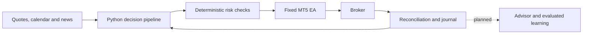

# FX-Talanta

**A forex trading system designed to make every decision explainable, risk-bounded and auditable.**

FX-Talanta is being built to analyze markets and news, execute trades within defined
risk limits, and improve decisions using recorded outcomes and failures. Separate
paper/live environments and a conversational advisor are part of that design.

**Today:** the offline foundation, market-data and calendar tooling, deterministic
risk controls and fixed MT5 execution gateway are implemented. A bounded FOREX.com
**demo** trade was opened, protected and closed, with independent broker verification
and same-session closure acknowledgement without recovery. Full connected acceptance is unfinished;
live and unattended strategy trading are **not enabled**.

[Try the offline demo](docs/guides/getting-started.md) ·
[Technical documentation](docs/README.md) ·
[Current status](docs/product/status.md) ·
[Roadmap](docs/product/roadmap.md)

## What it does

- **Observe markets and events:** MT5 quote channels, calendar imports and news
  records retain provenance, timestamps and revisions.
- **Constrain execution:** deterministic sizing and percentage-based risk budgets
  sit between a proposed decision and a fixed, reviewed Expert Advisor (EA).
- **Recover safely:** durable journals, idempotent messages and broker reconciliation
  distinguish a lost response from an order that never happened.
- **Make outcomes inspectable:** decisions, risk reservations, execution observations
  and corrections are recorded so explanations can point to evidence.

Production AI strategy selection, the conversational advisor and evaluated learning
are roadmap work. Scripted demonstrations are not autonomous intelligence.

## How it works

Python proposes; risk controls may veto; the EA independently checks authority,
freshness and protection before execution. Broker evidence determines the outcome.
The [architecture walkthrough](docs/architecture/overview.md) explains each boundary
and what happens when a component fails.

## Safety boundary

Trading is disabled by default. An explicitly authorized, bounded **demo** test is
separate from strategy trading and from LIVE activation. The two-second entry
freshness ceiling remains intact; a connected channel does not prove a fresh quote.
Historical qualification failures remain visible and do not become passes when
implementation code is merged. There is no automatic broker failover.

## Current status and roadmap

| Area | Status |
| --- | --- |
| Python/PostgreSQL foundation and isolated paper/live records | Implemented |
| Offline simulation, deterministic risk and restart recovery | Implemented and tested |
| Broker and USD/EUR/JPY news/calendar qualification (M1) | Incomplete; campaigns concluded without full qualification |
| Fixed EA and bounded demo execution (M2) | Bounded same-session demo closeout verified; full fault-matrix acceptance remains |
| Strategy baseline and replay (M3) | Research scope complete; B01 rejected for promotion; cost/availability gaps tracked |
| Bounded AI/advisor (M4) | Offline evidence foundation in development; production models and authentication pending |
| Trading dashboard | Planned |
| Unattended PAPER, capped LIVE and evaluated evolution | Later gated milestones |

See the [roadmap and acceptance boundaries](docs/product/roadmap.md). The dashboard
will show quote latency and the status of EA, Python-package and MCP channels.

## Engineering behind the product

The project emphasizes failure behavior as well as the successful path:

- Append-only PostgreSQL records, separate account credentials and checked migrations.
- Deterministic risk decisions and a fixed execution boundary, independent of a model.
- Journaled retries, lost-acknowledgment recovery and broker-confirmed closure.
- Native MQL5 checks, Python/PostgreSQL integration tests and isolated container profiles.
- Preserved [engineering evidence](docs/evidence/README.md), including failed and stopped runs.

Start with the [repository map](docs/architecture/repository-layout.md),
[development guide](docs/guides/development.md) or
[fixed-EA design decision](docs/adr/001-fixed-ea-execution.md).

## Run it locally

Use the [offline quick start](docs/guides/getting-started.md) for Windows or Unix.
It needs Python 3.11+ and an isolated PostgreSQL 17 database (Docker is supported).
The demo uses synthetic observations and simulated orders; no broker credentials
or AI subscription are required.

All product specifications, operating guides and evidence are in this repository.
No private chat or external project page is needed to understand the design.
