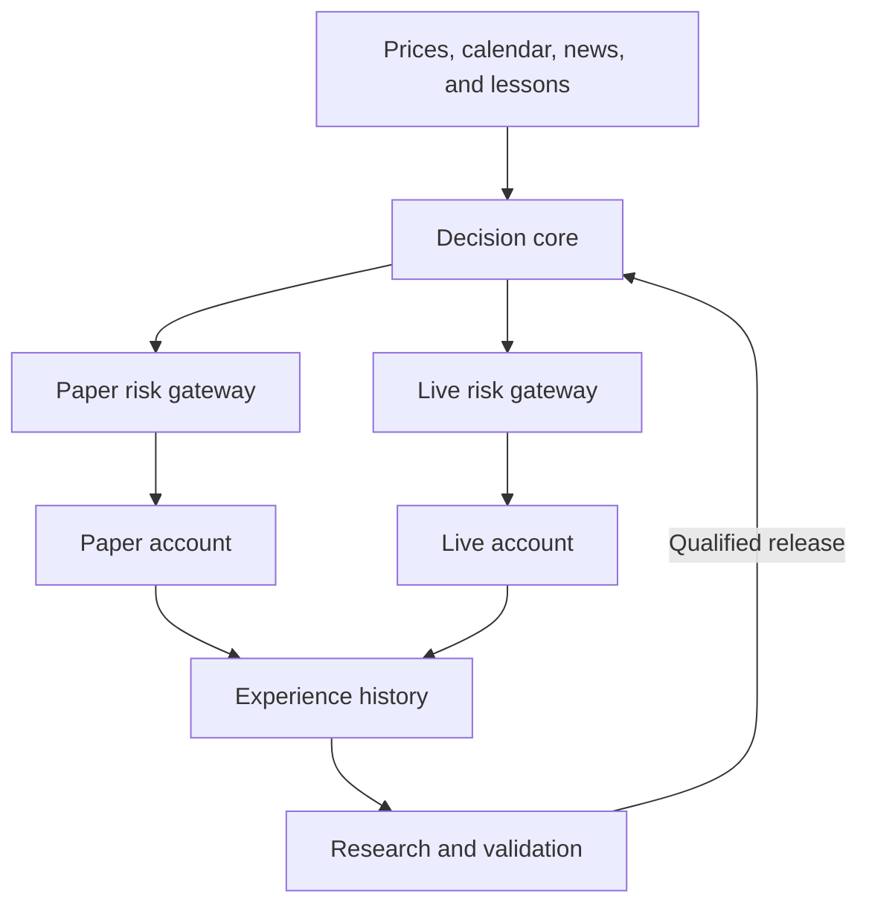

# FX-Talanta Architecture and Implementation Plan

This repository-maintained specification contains the full planning baseline.
See the [README](../README.md) for current implementation status and the
[documentation index](../README.md#documentation) for increment details and
operating instructions. Maintain project requirements here through pull requests.

**Build FX-Talanta as a fully autonomous forex trading system with a conversational advisor, automatic market-news monitoring, durable experience memory, a portable Python application core, isolated risk and execution gateways, and separate PAPER and LIVE accounts.** MT5 is the first broker connection. Normal trading, protective management, temporary-fault recovery, and qualified strategy deployment operate within fixed mandates without per-trade human approval.

**Planning baseline v0.3: 2 November 2026.** This specification includes natural-language user/advisor communication, automatic market-news search and evaluation, retained successes and failures, local/Docker/Codex-cloud execution profiles, and paper-first qualification followed by a separate live deployment. Numerical settings and strategy performance remain unvalidated. The first implementation increment is M0.

The principal risk is that reliable automation can execute a losing strategy reliably. Engineering acceptance and evidence of a trading edge are separate gates.

# Product mandate

| Item | Decision |
| --- | --- |
| Product and repository | **FX-Talanta**; repository **fx-talanta** |
| Purpose | Analyze prices and market news, trade within fixed mandates, explain decisions to the user, retain all experience, and evaluate improvements |
| Operating model | Single user; one dedicated PAPER account and one dedicated LIVE account; no per-trade confirmation |
| First execution route | Official Python MT5 integration through a running terminal |
| Broker portability | Strategy and risk interfaces are portable; each broker adapter and account mode must pass capability and execution tests |
| AI development | Separate research environment may generate strategy code; the live decision process cannot modify production code or risk limits |
| Relationship to M²D | Standalone product. M²D retains its existing portfolio and decision-support scope |
| Success criteria | Correct execution, account isolation, durable experience, portable operation, and independently evaluated net trading performance |

An autonomous system may decide to remain flat or stop trading. A persistent capital or integrity halt is a terminal safety outcome under the current mandate, not a request for someone to approve the next trade. Administrative changes to software, accounts, or capital are outside the normal trading loop.

# Initial scope

The following are implementation assumptions, chosen to keep the first version testable.

| Area | Initial boundary |
| --- | --- |
| Account | One dedicated PAPER account and one separate LIVE account; start with PAPER only; validate each account's trade and position modes |
| Instruments | **EURUSD and USDJPY**, subject to broker symbol mapping and minimum-size constraints |
| Strategy | One versioned trend-filtered breakout template, treated as an unproven research hypothesis |
| Decision schedule | Evaluate completed **15-minute bars**, using completed **1-hour bars** for trend context |
| AI authority | Select an eligible setup or HOLD; request an early close or tighter stop within registered rules |
| Protective management | Deterministic monitoring, stop verification, time exits, loss limits, and reconciliation operate independently of the AI |
| Positions | Maximum **two per account** concurrently and **one per symbol per account**; separate risk mandates; no adding, averaging down, or immediate reversal |
| Order entry | Market orders using a tested initial-SL or bounded fill-then-protect flow; verify protection and actual risk |
| Holding policy | Intraday; exit before the configured session/rollover cutoff and before the weekly close |
| Data | Broker quotes/history, a qualified calendar adapter, and versioned news evidence; fixtures and explicitly labeled simulated/demo/live evidence |
| Market news | Automatic approved-feed collection and bounded source search for USD/EUR/JPY; freshness checks, source attribution, and retained revisions |
| Conversational advisor | Authenticated text chat for questions, explanations, and permitted account-specific commands; English and Chinese as initial language targets |
| UI | Clearly separated PAPER/LIVE status, chat, history, lessons, decisions, news evidence/feed health, and incidents; administrative pause/flatten-and-halt controls |

Public SaaS features, multiple users, allocation across multiple live accounts, options, equities, high-frequency execution, martingale, grids, and unrestricted live code rewriting are outside the first release. The required paper/live pair is supported. Pending entry orders and multi-host failover are later extensions; reconciliation still detects unexpected pending orders.

# Paper and live accounts

**Maintain one dedicated PAPER account and one dedicated LIVE account.** Start trading in PAPER; keep LIVE inactive until the configured qualification and activation conditions pass. PAPER may continue alongside LIVE for monitoring and further research.

Distinguish the execution venue from the account environment. PAPER can use SIMULATOR for offline or recorded-market tests and BROKER_DEMO for actual MT5 demo execution. LIVE uses BROKER_LIVE. Label historical replay, forward simulation, broker demo, shadow decisions, and real fills separately; simulated and demo results are not live performance.

| Boundary | PAPER | LIVE |
| --- | --- | --- |
| Funds and performance | Virtual/demo balance and separate results | Actual broker equity, cash flows, costs, and results |
| Execution access | Paper-only credentials and endpoint | Live-only credentials and endpoint |
| Persistence | Dedicated paper database and role | Dedicated live database and role |
| Risk history | Own reservations, loss limits, and drawdown | Own persistent reservations, loss limits, and drawdown |
| MT5 connection | Separate demo terminal installation, data directory, and gateway worker | Separate real terminal installation, data directory, and gateway worker |
| Strategy | Incumbent qualification and challenger experiments | Exact qualified release within the live mandate |

Both databases may share a PostgreSQL server. Shared market data and research summaries retain account/environment provenance; a research view has no permission to write live orders or alter live risk history.

Each gateway is permanently bound to an environment, dealer/server, account login, terminal executable/data path, and expected broker trade mode. Validate those bindings at startup, after reconnection, and immediately before a mutation. Reject mismatches. The gateway endpoint and its credentials determine the permitted account; a model-supplied account field cannot redirect it.

MetaQuotes requires simultaneous terminal copies to use separate installation directories. Use distinct processes and data directories and never switch demo/live by logging a shared terminal into another account. [MT5 platform instances](https://www.metatrader5.com/en/terminal/help/start_advanced/start).

Every command, idempotency key, event, position, reservation, and incident is scoped by environment plus broker/server/account identity. The dashboard selector changes the displayed account, never the destination of existing commands. One writer per account permits paper and live to operate concurrently.

## Paper to live promotion

Promotion deploys the exact evaluated strategy artifact to the separate LIVE environment. The artifact includes code/configuration hashes, model and prompt versions, feature definitions, parameters, news-source and health policies, interpretation version, and compatible risk-policy version.

The release controller may activate a small live allocation automatically within a previously configured mandate when all of these conditions hold:

1. The configured paper observation period and required coverage have been completed for that candidate version.

2. Independent engineering and strategy-evidence gates pass, including realistic costs and uncertainty.

3. No unresolved material execution incident or unknown order remains for the target account.

4. The designated live account, allowed instruments, capital allocation, and loss limits are already configured.

5. The live gateway confirms its account identity, current broker state, required market/calendar/news health, and protective capabilities.

6. No live daily-loss pause or persistent halt is active; activation cannot increase capital or relax risk.

If evidence is insufficient, remain in PAPER automatically. Elapsed time alone never activates live orders. Normal trading and qualified activation require no per-trade approval.

Transfer strategy artifacts and referenced evidence only. Never copy paper balances, profits, positions, pending intentions, reservations, or loss baselines into LIVE. A previous live account's persistent risk history survives a new release. Old paper signals cannot be replayed as live entries.

After activation, retain a paper comparison of the live version and evaluate candidate improvements in separate simulated research ledgers. Those simulations do not require extra broker accounts. Pair paper/live observations when comparing outcomes; do not count copies of one signal as independent trades or combine their returns.

# System architecture

Use a small modular application with **two runtime trust boundaries**: the decision/research core and the trusted execution gateway. Instantiate the gateway separately for PAPER and LIVE. Shared strategy artifacts do not imply shared execution authority.



**Decision worker.** Builds point-in-time market context, evaluates registered candidates, calls the model when needed, and submits a typed intent. It has no broker password, terminal access, shell tool, arbitrary SQL authority, risk-policy write permission, or production deployment permission.

**News collector.** Read-only feed and search adapters collect source material outside the decision model's tool authority. They maintain immutable evidence versions and independently checked health records. The model cannot rewrite those records or mark a failed feed healthy; the trusted gateway evaluates configured freshness gates before allowing new risk.

**Conversational advisor.** Authenticates the owner, reads permitted account/evidence records, and translates explicit administrative requests into a separate typed command contract. It runs without broker credentials or risk-policy write access. The gateway validates each command and account binding; conversation history never substitutes for authoritative account state.

**Trusted gateway.** Owns deterministic risk checks, position sizing, atomic risk reservations, the sole broker mutation path, protective management, and reconciliation. Keep risk validation and sending within this same trusted process so a remote approval cannot become stale permission to trade.

**Persistence.** Use PostgreSQL from M0, supplied by Docker Compose locally and an isolated PostgreSQL service in Codex tasks when Docker is unavailable. Maintain separate PAPER and LIVE databases and runtime roles. Persist intentions, reservations, account state, execution evidence, experience cases, and release records. Research can read permitted evidence and write its own candidate records but cannot modify live ledgers. Versioned market/evidence files use persistent storage outside container images.

**Isolation.** Separate operating-system identities or equivalent process isolation enforce the boundary. Prompt instructions alone are insufficient. The live AI receives only narrowly scoped market-reading and intent-submission capabilities.

**Single writer.** Maintain one gateway writer per account, with distinct PAPER and LIVE processes and bindings. A watchdog may restart a confirmed-dead process. Concurrent paper and live execution is allowed; a second host for the same account cannot activate while the predecessor may still submit orders. A database lease alone does not fence broker access.

# Technology and deployment

| Component | Recommended implementation |
| --- | --- |
| Trading and risk domain | Python with typed models and decimal-safe monetary calculations |
| API and command validation | FastAPI and Pydantic; authenticated advisor queries and typed administrative commands |
| Execution | Windows-only MetaTrader5 dependency inside each isolated MT5 gateway |
| Storage | PostgreSQL from M0, separate PAPER/LIVE databases; durable event/evidence storage and backups |
| News and calendar | Provider interfaces, approved sources, scheduled collection/search, immutable evidence, and independent health checks |
| Model access | Provider interface with OpenAI API first; credentials supplied through environment or secret configuration |
| Other model providers | Gemini or Claude adapters later; each provider/model change needs its own evaluation |
| Testing | Pytest, scripted DecisionSource, fake clock, broker simulator, fault injection, and cross-profile contract tests |
| Monitoring interface | Small React/TypeScript monitoring and conversational interface after the core loop works |
| Deployment | Portable native/Docker core, Windows MT5 gateways, and a Codex-cloud development/test profile |

The official Python package exchanges data with the MT5 terminal and exposes account, quote, history, and trading functions. A custom EA is not required for this execution route. [MT5 Python integration](https://www.mql5.com/en/docs/python_metatrader5) and [Python order_send](https://www.mql5.com/en/docs/python_metatrader5/mt5ordersend_py).

Use **native Windows for the first gateway**, with the terminal and Python adapter on the same machine. The currently published package files are Windows x86-64 wheels. This is a deployment choice based on the supported distribution, not a claim that every compatibility workaround is impossible. [Published package files](https://pypi.org/project/metatrader5/#files).

Unattended MT5 operation includes a named terminal-supervision work item: an external watchdog, supervised native-call worker, explicit account checks, build-change detection, and reboot/session/update recovery drills. The built-in updater cannot be permanently disabled; hold new entries after a build change until compatibility checks and reconciliation pass. A full Windows host supplies the terminal environment; MetaTrader's built-in EA/chart virtual hosting does not host the entire Python application. [Live Update](https://www.metatrader5.com/en/terminal/help/start_advanced/autoupdate) and [virtual-hosting migration](https://www.metatrader5.com/en/terminal/help/virtual_hosting/virtual_hosting_migration).

**MCP is optional.** Calendar data may come through a restricted read-only MCP adapter, a tested MQL5 bridge, or another qualified provider; the documented Python API does not expose calendar functions directly. MetaTrader also documents news access, including `marketdata_symbol_news`; confirm actual forex coverage, timestamps, retention rights, and tool availability before selecting it as a news provider. Expose only the specific read operations through the collector, with native trading, shell, and editor tools unavailable to the live model. Use development tools in isolated research. [Official MCP capabilities](https://www.metatrader5.com/en/terminal/help/mcp_and_ai/capabilities).

## Supported deployment profiles

Use the same versioned application package and configuration schema across environments. Container images carry application code and dependencies; account state, evidence, credentials, and risk history live outside the image.

| Target | Application core | Execution and persistence | Supported purpose |
| --- | --- | --- | --- |
| Local native | Python services on the user's machine | Local PostgreSQL; Windows MT5 gateways where broker execution is enabled | Development, PAPER, and qualified LIVE |
| Local Docker | Linux core containers under Docker Desktop or another compatible engine | Persistent PostgreSQL volumes; native Windows MT5 gateways reached through a private authenticated connection | Reproducible local runtime |
| Cloud Docker | The same core images on an always-on cloud host | Persistent or managed PostgreSQL, durable evidence storage, and a Windows MT5 gateway host | Continuous PAPER and qualified LIVE |
| Codex cloud | Repository setup runs the same Python package, application commands, and tests; image workflows where supported | Isolated test databases and fixture/paper adapters; export required results to durable storage | Development, replay, failure tests, application smoke tests, and task-scoped paper runs |

**MT5 boundary.** Keep the MetaTrader5 package as a Windows-gateway dependency; importing the Linux core must not import it. The trusted gateway contains the authoritative risk governor and protective manager. A cloud core disconnection stops new exposure but does not remove the gateway's existing protective rules.

The MT5 terminal and its Python integration remain together on the selected Windows host. Do not promise that the initial MT5 production stack fits inside one Linux container. A later broker adapter with an appropriate direct API can enable an all-Linux runtime after its own qualification.

**Codex cloud boundary.** Official documentation describes isolated task workspaces and saved task state; it does not establish an always-on trading-host guarantee. This plan therefore supports running and testing the application during Codex tasks while assigning continuous trading to the persistent deployment. [Codex cloud environments](https://learn.chatgpt.com/docs/environments/cloud-environments).

Provide a checked setup script and explicit run/test commands for Codex. Use PostgreSQL with the same migrations and semantics: start a test service natively when a Docker daemon is unavailable, or use an explicitly provisioned isolated test database. Do not silently substitute SQLite. The Codex test profile must work without MT5 or an LLM key and must not inherit live credentials or access to live execution endpoints. A task-scoped forward PAPER connection is optional only after paper-only network access is configured and verified.

## Persistence and moving hosts

Retain the paper and live journals, evidence snapshots, lessons, deployment records, and risk histories through container restarts, image upgrades, and local/cloud migration. Use persistent database/storage volumes and separate backups, including the gateway emergency journal. Test restoring both histories without resetting limits or losing unknown operations.

For a core-only move, keep the authoritative gateway and revoke the old core's writer authority before issuing the new identity. For a gateway move, pause entries, resolve uncertain operations, verify protection, back up state, stop and disable the old writer, restore the destination with trading disabled, then reconcile before resuming. If the old writer may still trade, the new gateway stays halted. Running local PAPER and cloud LIVE is permitted; two independent deployments cannot write to the same live account.

A container image or a Codex workspace cache is not the experience database. An unreconciled or stale restore must block new exposure rather than silently discard incidents, drawdown, or reservations.

# Market news and economic events

FX-Talanta automatically collects approved market-news feeds and searches approved sources for developments relevant to **USD, EUR, and JPY**. The economic calendar supplies scheduled-event timing; news supplies releases, statements, and unscheduled developments. Evidence is collected before AI interpretation is enabled so prospective records begin in M1.

## Coverage and sources

| Coverage | Initial focus |
| --- | --- |
| Central banks | Federal Reserve, ECB, and Bank of Japan decisions, statements, minutes, and speeches |
| Economic releases | Inflation, employment, growth, and other configured high-impact releases; actual, previously observed consensus, prior value, and revisions where a qualified provider supplies them |
| Government and geopolitics | Fiscal/trade policy, sanctions, conflict, and material energy developments relevant to the monitored currencies |
| Currency intervention | Japanese Ministry of Finance and other relevant official communications; separately labeled market reports or speculation |
| Targeted search | Follow up relevant events, locate original statements, and resolve conflicting reports within the approved-source and request budget |

Prioritize original central-bank, statistical-agency, and government publications for official claims. Use a qualified news provider for broader coverage and an approved search adapter for discovery and verification. Search snippets and syndicated copies are leads, not independent confirmations. Preserve the underlying source or explicitly mark evidence unavailable; do not manufacture missing release values, consensus, publication times, or certainty.

Qualify provider coverage, latency, licensing/retention, timestamps, revisions, rate limits, and outage behavior before relying on its output in M1. The provider decision remains a P0/M1 prerequisite. MT5 news may be one adapter; it is not assumed to provide complete FX coverage. Social-media rumors are excluded from initial trading inputs.

## Collection and health

Use one portable `NewsProvider` interface and a bounded `NewsSearchProvider` interface across native, Docker, and Codex profiles. M0 uses fixtures; M1 adds real read-only adapters. API credentials stay outside images. Shared news evidence may be read by PAPER and LIVE, but each decision and outcome keeps its own account binding.

Initial configurable scheduling targets are **60-second feed checks** and **15-minute targeted searches** during enabled monitoring windows, adjusted to provider limits and qualified coverage needs. Relevant high-impact items may trigger a bounded verification search. Cache and deduplicate results, limit query/response size, and enforce timeouts, retry limits, backoff, and daily spend. Searches send market topics only, without account identifiers, positions, or secrets. These targets do not promise publication-time delivery.

Track connection health separately from content health: last successful check, provider cursor/watermark where available, timestamps, coverage/pagination, expected scheduled releases, and independent source checks. HTTP success or repeated old results cannot establish current coverage. Session-aware rules must also distinguish a legitimately quiet feed from a failed one. Provider-specific maximum check age, release-lateness tolerance, and recovery criteria are versioned configuration required before the live gate; unknown health is not healthy.

Declare required and optional sources in the qualified release. Failure or unverifiable freshness of required coverage blocks new entries through the trusted gateway and records an incident; deterministic protection and exits continue. An optional source may degrade only under the predeclared policy. The model cannot silently substitute a provider, remove a requirement, or bypass a calendar blackout. News retrieval runs outside the order-send and protective-management path.

## Evidence and permitted decisions

Store provider/source identity, canonical URL or item ID, headline, permitted content or extract, content hash, story cluster, affected currencies, and all revisions. Keep event time, source publication/update time, first observation, ingestion time, and availability to the decision distinct; normalize to UTC while retaining the original timestamp/zone. Append corrections and link them to the prior version. A late-discovered article cannot enter a decision earlier than its actual availability, even if its publication date is old.

Record every scheduled fetch and search, including the query/filter, result IDs, zero-result responses, duplicates, errors, throttling, and health checks. Each interpretation and decision references the exact evidence versions and cutoff. A restarted collector may archive a backlog, but expired relevance cannot trigger a new trade. Retain rights-permitted evidence durably and record gaps when full content cannot be retained.

The AI returns a typed interpretation: evidence IDs, affected currencies, event category, factual summary, directional hypothesis if any, relevance expiry, uncertainty/conflicts, and a short rationale. Facts and inference remain distinguishable. Retrieved articles are untrusted data: embedded instructions cannot call tools, choose an account, change policy, or release capital.

At the scheduled decision cycle, news may support accepting or skipping an existing eligible setup, HOLD, or a registered early-close/tighter-stop proposal. It does not create headline-only entries or relax size, stop, expiry, exposure, loss, or scheduled-event limits. Uncertain evidence produces the configured conservative outcome. The gateway still validates current prices, account state, input health, and permitted actions.

## Learning and qualification

Link news evidence and interpretations to accepted trades, HOLDs, rejected proposals, retrieval failures, and subsequent outcomes. Preserve successful and failed interpretations, conflicting reports, and corrections using the existing operational/compliance/economic labels. A profitable trade after a headline does not establish that the headline caused the profit.

M5 compares the news-enabled AI with an otherwise matched AI policy that receives no news content, using separate prospective paper ledgers and the same common safety inputs. Include data/search/model costs and measured latency. News features or lessons become live behavior only through the existing candidate-evaluation and release gates; monitoring and evidence retention continue even when a news feature fails to qualify.

# Conversational advisor

Provide an authenticated, persistent **text conversation between the owner and FX-Talanta**, available through the same application in local and cloud deployments. English and Chinese are initial language targets, with identical account, command, and risk semantics. Trading, position protection, and recovery remain autonomous while the user is absent or the conversation is idle.

## Questions and explanations

| User request | Advisor response |
| --- | --- |
| “Why did you enter EURUSD in PAPER?” | Recorded signal, news/lesson evidence, decision rationale, passed risk checks, and actual broker outcome |
| “How is LIVE performing this week?” | Account-specific net results, costs, drawdown, open risk, and comparison period/timezone |
| “What news affects USDJPY?” | Relevant current source links, publication and observation times, interpretation, uncertainty, and any active restrictions |
| “What went wrong, and what did you learn?” | Linked incidents, losing and winning cases, corrective action, test results, and qualified versus proposed lessons |
| “Compare PAPER and LIVE.” | Clearly separated balances, positions, results, execution assumptions, and paired observations |
| “Are you running normally?” | Current operating state, feed/terminal health, unresolved requests, and reasons for pauses or halts |

Answer from typed read tools and recorded evidence. State the account/environment and as-of time; use explicit date boundaries and timezone for relative periods. Numerical performance and risk measures come from deterministic queries. Explanations distinguish the recorded rationale from later analysis, and unknown or stale state remains labeled. Link to the exact trade, news item, incident, or lesson instead of inventing an explanation.

The app may add concise in-app updates for executed trades, confirmed exits, material news restrictions, faults, recoveries, and learning/release results, with configurable verbosity. They report activity and status without asking for routine trade approval. External messaging channels and voice input can be later adapters.

## Natural-language commands

Questions and commands use separate contracts. An authenticated, explicit command may request **PAUSE_ENTRIES**, **RESUME_ENTRIES**, **CLOSE_OWNED_POSITION**, or **FLATTEN_OWNED_AND_HALT** within the configured mandate. For example, “Pause LIVE entries” or “Close LIVE position 12345” identifies the target. The current dashboard view never chooses the destination of a mutation.

For an interpreted action, the server assembles a typed administrative request containing authenticated user identity, original message/conversation IDs, unique request ID, target environment/account, action, exact owned position where applicable, expiry, and expected state version. Authentication/account scope is assigned by the server, not accepted from model output. An account-bound command router and the existing trusted gateway enforce authorization, ownership, fresh state, policy, and durable idempotency. All broker mutations use the existing sole execution path and reconciliation.

Clear authorized requests execute without a second routine approval step. If intent, account, or position is ambiguous, ask a focused clarification and submit no command. Questions, hypotheticals, quotations, and retrieved material do not authorize mutations. A negated action such as “do not close” must never be inverted into a close command. A clarification timeout never becomes consent. Autonomous protective management continues throughout.

RESUME_ENTRIES may clear an administrative entry pause only after health and reconciliation checks; every other trading gate still applies. It cannot clear a loss pause, persistent halt, unknown execution, or missing live qualification. A close uses the actual owned position and remaining volume and cannot create a reversal. Requests to change strategy, capital, risk limits, credentials, or code become explicit configuration/research proposals governed by the existing mandate and release process. Natural-language preferences cannot silently alter a live policy. Initial commands are immediate; conditional instructions such as “close after tomorrow’s release if it disappoints” require a separately specified, persistent, evaluated rule.

Report command status precisely: interpreted, accepted or rejected, submitted, outcome unknown, or broker-confirmed completion. “Close requested” is distinct from “position closed.” Duplicate submissions, refreshed browser pages, and repeated delivery of the same message retain one request identity; reloading conversation history never re-executes commands. Uncertain broker results follow OUTCOME_UNKNOWN rather than a blind resend. Serialize administrative state changes with autonomous order checks inside the gateway so an accepted pause blocks subsequent entries; any request already submitted remains subject to reconciliation.

## Audit and availability

Persist user messages, advisor responses, tool/evidence references, interpreted commands, validation results, actual execution outcomes, and language/model/prompt versions with account scope and timestamps. Redact credentials and other secrets. Conversation records may support incident analysis, but an unverified conversational claim cannot become a qualified trading lesson.

Keep conversation handling outside the protective-management loop with separate timeouts and resource budgets. An unavailable model or chat service must not stop deterministic protection. The authenticated dashboard pause/flatten controls remain reachable independently of the conversational model. Enforce owner authentication and account authorization for both read and command APIs, with private/TLS-protected access for cloud deployments.

M0 defines conversation/command records and fixtures only. M4 implements evidence-backed advisor queries and command interpretation against simulated gateways. M5 integrates the dashboard chat, notifications, real paper administrative actions, and failure tests. LIVE command access is enabled only for the qualified M6 account and deployment.

# Decision and execution contracts

## Autonomous decision cycle

1. Capture broker account state, bid/ask quotes, completed bars, symbol specifications, calendar data, and the news evidence/health snapshot available by the decision cutoff. Collection runs independently of this trading cycle.

2. Check that inputs are complete and fresh. Build candidates using the frozen strategy template.

3. Ask the model to select an eligible candidate, choose an allowed exit option, or return HOLD. Record the supplied evidence, exact news versions, interpretation and retrieved lesson versions, response or failure, and account/environment even when the result is HOLD.

4. Validate the response schema, references, strategy version, and expiry.

5. In the trusted gateway, refresh quote and account state, calculate executable size, and reserve exposure atomically.

6. Persist the intended broker request before sending. Run broker preflight, recheck conditions, then send through the only execution path.

7. Reconcile acknowledgments, orders, deals, fills, positions, and stops. A request acceptance is not sufficient evidence of a fill.

8. Continue deterministic management until the position is confirmed closed. Append realized results, costs, operational/compliance labels, and lessons or research links without erasing earlier attempts.

MT5's order-check and send results must be interpreted separately; a successful preliminary check or request acceptance does not establish completed execution. [order_check](https://www.mql5.com/en/docs/python_metatrader5/mt5ordercheck_py) and [OrderSend semantics](https://www.mql5.com/en/docs/trading/ordersend).

## Intent schema

| Field group | Required information |
| --- | --- |
| Identity | Unique scoped intent ID, environment, dealer/server/account binding, strategy release, policy version |
| Action | ENTER, CLOSE, TIGHTEN_STOP, or HOLD; instrument and side when applicable |
| Entry | Candidate ID, allowed entry conditions, maximum adverse price movement, expiry |
| Protection | Stop rule or validated stop level, target rule, maximum holding time |
| Existing position | Position identifier and expected reconciled state version for close/modify requests |
| Evidence | Market/calendar/news snapshot IDs and health record, news interpretation version, qualified lesson IDs and activation times, decision cutoff, short rationale |
| Model trace | Provider, requested/returned model identifiers, snapshot when available, prompt/configuration version, request ID, latency, usage |

The gateway calculates final volume. A model's confidence score is not a calibrated probability or position-sizing input. Prices, symbol names, and evidence references must resolve against the captured data rather than being accepted because the model supplied them.

Conversational administrative requests are distinct from strategy intents. They carry authenticated user/message identity and an explicit account target, pass the command contract above, and enter the same gateway validation and broker lifecycle. The advisor cannot bypass risk checks by classifying a request as a user command.

## Order lifecycle

Track CREATED, VALIDATED, RESERVED, SUBMITTING, ACKNOWLEDGED, PARTIALLY_FILLED, FILLED, PROTECTION_PENDING, PROTECTED, and COMPLETED, with explicit REJECTED, CANCELLED, and OUTCOME_UNKNOWN branches. Scope every state transition to its environment/account; keep order, deal, position, and experience records distinct.

An expired intent is rejected. A timed-out send is **not** an expired intent: it may already have executed. Retain its reservation and reconcile it.

Internal IDs and broker correlation tags support deduplication and matching; the design must not promise broker-side exactly-once execution. After an uncertain send, cancellation, or close, never submit a replacement merely because a response was lost.

Handle partial fills as actual filled exposure plus reserved remaining exposure without double counting. Recalculate risk from actual fill prices and volumes; a material breach triggers the predefined reduce-or-close procedure rather than a silent budget increase. A stale close command must not reverse a net position or open a new hedge. Read account mode, allowed fill policies, volume steps, stop distances, and freeze constraints from the broker. In particular, Market Execution does not permit the immediate-order RETURN filling policy. [Account modes](https://www.metatrader5.com/en/terminal/help/trading/general_concept) and [symbol properties](https://www.mql5.com/en/docs/constants/environment_state/marketinfoconstants).

# Risk policy

These are **uncalibrated PAPER/demo defaults**, applied independently to that account. LIVE has a separately configured capital allocation, policy, loss baselines, and stricter initial qualification limits. Promotion never copies paper profits or loss history into live risk capacity. These figures are not validated live settings or guarantees of maximum loss.

| Control | Initial demo setting |
| --- | --- |
| Per-trade planned risk | At most **0.25%** of eligible account equity |
| Aggregate open and reserved risk | At most **0.50%** of eligible equity |
| Concurrent positions | At most **2**, one per symbol |
| Daily equity-loss threshold | **1.0%** of start-of-day equity, adjusted for external cash flows |
| Persistent drawdown threshold | **5.0%** from cash-flow-adjusted high-water mark |
| Gross pair notional / equity | At most **2×**, counting each pair's base notional once in account currency |
| Absolute net exposure to any currency | At most **1×** equity after converting the currency legs into account currency |
| Margin usage | At most **20%** of equity, with broker stop-out stress headroom |
| New-entry quote age | At most **2 seconds**, rechecked at submission |
| Decision expiry | **60 seconds**; fresh conditions are still required |
| Scheduled high-impact events | No entries from **30 minutes before to 30 minutes after** an affected-currency event |
| Required calendar, quote, or news coverage unavailable/unverifiably stale | No new entries; required news sources are declared in the qualified policy |
| Stop widening, adding, grids, martingale | Disabled |
| LLM spend and retry budget | Explicit configured cap; exhaustion disables new AI-driven entries |

Position-count limits cover open positions and every pending, in-flight, or outcome-unknown entry that could still create exposure; an unconfirmed cancellation retains its slot.

The smallest applicable limit wins. Size from the lower of current equity and the configured capital allocation, excluding unclassified credits or cash flows; a deposit cannot silently enlarge that allocation. Currency caps are additional constraints, not substitutes for aggregate stop risk. Do not offset separate positions' stop risks with optimistic hedging assumptions. Per-symbol spread and adverse-slippage limits must be calibrated from the broker's observed distributions before demo qualification.

## Sizing

Estimate loss from executable entry to protective exit **in the account currency**, including applicable commission, financing allowance, and conservative slippage. Use coherent bid/ask assumptions so spread is not counted twice. MT5's profit-calculation function returns an estimate in the account currency. [order_calc_profit](https://www.mql5.com/en/docs/python_metatrader5/mt5ordercalcprofit_py).

Calculate the maximum permitted size under trade, aggregate, currency, notional, margin, and remaining loss-budget constraints. Current daily losses plus existing current-to-stop exposure, outstanding reservations, the proposed trade, and cost buffers must fit the remaining daily loss mandate. Round **down** to the valid volume increment. If the minimum lot exceeds any limit, return HOLD; never round up or automatically add capital.

For existing positions, aggregate risk measures potential equity decline from the current liquidation value to the stop, floored at zero per position, plus incremental exit costs. Add remaining pending/in-flight reservations. An outcome-unknown request keeps its full unresolved reservation. Broker-confirmed risk reductions may release the corresponding reservation.

## Loss accounting

Daily trading P&L equals current equity minus start-of-day equity minus net external cash flows. Include realized and unrealized P&L and reconcile trading costs consistently. Fix the risk-day boundary at **00:00 UTC** so restarts and daylight-saving changes cannot reset it.

Use unitized, cash-flow-adjusted NAV for persistent drawdown. Deposits do not erase a breach; withdrawals immediately reduce available exposure capacity. Unclassified cash movements block new entries.

At the daily limit, stop entries, cancel risk-increasing pending orders, and attempt controlled closure of owned positions. Resume only at the next risk day after reconciliation and health checks pass, with no persistent halt active. A hard drawdown breach does not clear on a timer.

## Protection and execution limits

Support two broker-qualified protection flows: submit the opening request with SL where accepted, or enter PROTECTION_PENDING after a confirmed fill and immediately attach SL through the trusted gateway. MetaQuotes documents server-dependent restrictions on initial SL/TP and no API property that reliably identifies them in advance. Never strip protection and blindly resubmit an unexplained rejection. The fill-then-protect mode must be explicitly configured, measure the potential unprotected interval from submission, block further entries, and invoke bounded repair/controlled closure when its deadline or risk conditions fail. Verify protection after every fill and relevant modification. [Broker-dependent stop placement](https://www.mql5.com/en/book/automation/experts/experts_market_buy_sell).

Broker-side SL/TP remains at the server when the local application fails. A terminal-computed trailing stop does not continue recalculating while its terminal is offline. [Server-side stops](https://www.metatrader5.com/en/terminal/help/trading/performing_deals).

Stops and account thresholds are control triggers, not guaranteed loss caps. A market gap, unavailable liquidity, disconnected terminal, or rejected close can prevent execution at the intended level. Keep the actual unresolved exposure visible.

# Recovery and operating states

| State | New entries | Position handling | Automatic transition |
| --- | --- | --- | --- |
| STARTUP_RECONCILE | Blocked | Read account, history, outstanding requests, and protective stops | RUNNING only after state agrees |
| RUNNING | Allowed within every limit | Normal management | Move to the relevant restricted state on a guard breach |
| DEGRADED_PROTECT | Blocked | Continue available deterministic protection and exits | Resume after required inputs recover and repeated health checks pass |
| OUTCOME_UNKNOWN | Blocked for the account | Preserve reservations and reconcile uncertain mutations | Resolve to the actual broker outcome; never guess that a trade failed |
| PROTECTION_PENDING | Blocked for that account | Attach and verify SL; bounded repair or controlled close | RUNNING only after all required protection is confirmed and health checks pass; uncertain mutations enter OUTCOME_UNKNOWN |
| LOSS_PAUSE | Blocked | Cancel risk-increasing orders and attempt controlled exits | Next risk day only if state is known and no persistent halt applies |
| HARD_HALT | Blocked persistently | Continue feasible protection and closure | Remains stopped under the current mandate |

**LLM outage or invalid response:** record HOLD, enforce the retry/spend cap, and leave protection independent of the model.

**Required news coverage unhealthy:** block new entries, record the affected source and health evidence, and continue deterministic management. Recovery requires the configured freshness/completeness checks and a newly valid decision snapshot. Backfilled headlines cannot resurrect expired intentions.

**Restart:** recover the account-scoped journal, verify the configured terminal path, login, server, environment, and broker trade mode, reconcile all outstanding requests and positions, and restore that account's existing loss baselines. Never initialize against the last saved account or copy paper state into live.

**Database unavailable:** block entries. Preserve existing broker-side protection. Only the tested emergency management path may submit freshly reconciled, non-reversing protective actions, recording them in a durable local emergency journal before submission; replay and reconcile that journal before resuming. If a previous action remains uncertain, do not repeat a close or modification to ensure completion. If that journal is also unavailable, do not claim broker changes were recorded or confirmed.

**Broker disconnected or market closed:** closure may be impossible. Keep the position classified as open or unknown; retry bounded recovery when connectivity returns. Never label a requested flatten as a confirmed flat account.

**Unexpected external activity:** freeze new risk and reconcile. A dedicated account limits ambiguity, but the system must not silently assume ownership of an unexplained position or liquidate unrelated holdings.

**Hard drawdown or corrupted state:** stop automatically and persist the halt. Trading does not wait for a human response. Any later reactivation requires a separate deployment/mandate change; the decision model cannot grant itself that authority.

Alerts identify the account/environment, fault, limit, exposure, and recovery. They are informational, not approval requests. Administrative PAUSE_ENTRIES and FLATTEN_OWNED_AND_HALT commands reach the trusted gateway independently of the AI; disable entries first, reconcile cancellations/closures, and preserve unknown outcomes. A requested flatten is not proof that the account is flat.

# Strategy research and validation

## Initial baseline hypothesis

Start with one deterministic template, B01, to make the AI's contribution measurable:

- Long candidate: the latest completed H1 EMA50 exceeds EMA200, and the latest completed M15 close exceeds the highest high of the **previous 20 completed M15 bars**, excluding the signal bar.

- Short candidate: the conditions are mirrored.

- Entry: next executable quote after signal availability, within the **60-second** decision window and configured spread/price-movement constraints.

- Initial stop distance: **1.5 × M15 ATR14**, calculated from completed bars.

- Target: **2 times the initial price-risk distance**; report realized reward/risk after costs separately.

- Time exit: after **16 M15 bars**, or earlier at the configured intraday cutoff.

- No new position where one already exists; no reversing or adding. Freeze indicator seeding, rounding, session, and bar-availability conventions in the versioned specification. Pre-register timezone/DST-aware session windows or the first session comparison before examining strategy results; retain session labels from the first recorded decision.

These numbers define an experiment, not a claim that the strategy is profitable. The primary counter-thesis is that breakout signals can fail in ranging conditions and trading costs can eliminate any gross edge.

The no-LLM baseline executes every eligible template signal within the same risk policy. The AI variant may accept or skip candidates and choose permitted management actions. AI-generated alternative strategies remain research candidates until separately qualified.

## Historical evaluation

Use the same strategy and risk components in replay and runtime, substituting clock, data, and broker adapters. Implement an event-driven Python simulator. MT5's Strategy Tester is designed around EAs and indicators; it is not a direct replay engine for arbitrary Python strategy code. [MT5 Strategy Testing](https://www.metatrader5.com/en/terminal/help/algotrading/testing).

Require chronological training/tuning, walk-forward evaluation, and a final untouched holdout. Track every tried variant. Repeated selection can overfit a financial backtest, including when a holdout is used casually. [Bailey and colleagues on backtest overfitting](https://scholarworks.wmich.edu/math_pubs/42/).

Model broker-relevant bid/ask spread, commissions, slippage, swap where applicable, volume constraints, rejected/partial orders, and gaps. If only OHLC data is available, use conservative intrabar ordering when a stop and target could both be reached; do not silently pick the profitable sequence.

Retain market event time, arrival time, decision time, and data completeness. A bar is available only after it has closed and could have been received. Calendar/news features must use the exact release or article version available by the decision cutoff, with source publication and first-observed/available timestamps. Later revisions and retrospectively discovered stories cannot be presented as contemporaneously observed evidence.

## AI evaluation

Timestamp-correct inputs alone do not prove a current model is free of historical outcome knowledge. Research has documented this form of look-ahead bias in financial LLM testing. Therefore treat historical AI results as supporting evidence and prioritize decisions logged prospectively before outcomes occur. [Research on model-memory look-ahead bias](https://aclanthology.org/2026.emnlp-main.510/).

Run the AI policy and no-LLM baseline on identical prospective snapshots with separate simulated ledgers. Freeze strategy, prompt, feature builder, inference settings, and the provider's versioned model identifier when available. Log requested and returned identifiers; if immutable model versions are unavailable, record the limitation and qualify detected changes as new candidates. Include the exact set of activated lessons, news sources/health rules, and interpretation version in the evaluation version.

Evaluate news separately from the existing AI-versus-no-LLM comparison: run matched AI policies with and without news content on the same prospective price/candidate snapshots, frozen model/prompt family, and separate simulated ledgers. Keep calendar blackouts, required-feed health gates, capital/risk rules, and other safety inputs common; predeclare the news fields and interpretation step as the experimental difference. Record both decisions before outcomes and account for their actual latency, search/data/model cost, and missed entries. Use paired comparisons with uncertainty rather than counting copies of one signal as independent samples. News-disabled simulation does not require a third broker account or authorize a silent live fallback.

Measure net expectancy, drawdown, exposure, turnover, fill quality, costs, decision latency, and the AI's incremental value. Use uncertainty estimates that account for dependent trades. Predeclare acceptance thresholds before viewing the final results; if evidence is insufficient, remain in demo or shadow mode.

Use a configurable minimum paper observation period and evidence requirement, initially **8 weeks and 100 closed trades, whichever takes longer**, without increasing trade frequency to reach the count. Apply the requirement to the candidate being qualified. This operational floor is not proof of profitability and does not alone activate LIVE; insufficient evidence keeps the candidate on PAPER.

Measure actual API, data, and hosting expense at the intended account size. Call the model on eligible events or completed bars rather than every tick. Do not silently swap providers during a live evaluation. If the AI adds no net value, disable its live trading policy and retain it for research; a deterministic alternative needs its own deployment qualification.

# Experience history and continuous improvement

**Preserve the complete history of successful and unsuccessful decisions, execution attempts, incidents, recoveries, and research experiments.** Recording begins in M0 and continues through PAPER and LIVE. Store evidence independently of chat history, a model's context window, or a container's lifetime.

## Records and outcome labels

| Record | Required evidence |
| --- | --- |
| Event journal | Immutable event ID, environment/account scope, sequence, component/version, timestamps, correlations, and state transition |
| Decision attempt | Input snapshot, candidates, selected action or HOLD, concise rationale, model response/version, latency, cost, and error if any |
| News retrieval and interpretation | Source/query, exact item/revision IDs, publication and availability times, fetch/health result, uncertainty/conflicts, interpretation version, and linked decisions/outcomes |
| Conversation and administrative command | User/advisor messages, authenticated actor, interpreted action, explicit account/position, evidence references, request ID/expiry, validation result, and actual outcome |
| Risk evaluation | Checked limits, approval/rejection reasons, size, policy version, and reserved exposure |
| Execution attempt | Submission benchmark, exact request, broker responses, partial fills, retries, rejection, cancellation, unknown state, and reconciliation |
| Experience case | Linked decisions/events, operational result, policy compliance, economic outcome, costs, uncertainty, and outcome-known time |
| Incident and recovery | Exception, stale input, disconnect, restart, missing protection, attempted repair, actual resolution, and regression-test reference |
| Learning candidate | Hypothesis, supporting and conflicting cases, sample size, effect estimate, uncertainty, and proposed bounded change |
| Evaluation and release | Every attempted candidate, frozen data/configuration, baseline, acceptance criteria, result, rejection/promotion, deployment, and rollback |

Record expected risk rejections and HOLD decisions as well as exceptions and completed trades. Preserve successful recoveries and safe halts. An execution outcome remains UNKNOWN until broker evidence resolves it. Keep hypothetical outcomes of skipped trades in a clearly labeled counterfactual dataset; never add them to realized performance.

Label each experience on three separate axes: **operational result**, **policy compliance**, and **net economic outcome**. A correctly executed losing trade is not automatically a software failure. A profitable policy violation is not an example to imitate. One missed rally after HOLD does not prove that HOLD was wrong.

Store the supplied inputs, returned model response, and decision summary needed for audit; do not depend on hidden model reasoning. Redact secrets, passwords, and tokens. Preserve market-data provenance and permitted input snapshots; retain source identifiers, hashes, and explicit evidence gaps where source terms limit raw-content retention.

## Durable retention and replay

The event journal is append-only under runtime permissions. Corrections and revised outcome labels append a superseding event rather than erasing the original. Keep records by default; compression and archival may move them without losing identity, provenance, or retrieval. The learner has no authority to delete failures or rewrite experiment history.

Persist intent before an external mutation and append the outcome afterward. Database outages block new entries. The predefined durable emergency journal records necessary protective actions before submission and is reconciled when storage recovers. An abrupt failure before an event can be persisted must produce a detected journal/recovery gap when possible; do not claim perfect capture after unrecoverable host or disk loss. Backups and restore drills are part of the retention requirement.

Keep market event time, source publication/revision time, first observation, availability to the decision, decision cutoff, outcome-known time, and lesson creation/activation time distinct. A replay can use only evidence and lessons available at its historical cutoff. Rerunning today's model on old data is a different experiment from replaying the recorded historical decision.

## Learning and promotion cycle

1. Collect and classify experience from trades, HOLDs, rejections, errors, recoveries, and unsuccessful research.

2. Identify repeatable patterns by strategy/model version, account environment, instrument, session, regime, news event/source quality, and cost conditions.

3. Create a candidate hypothesis with supporting and contradicting evidence; do not count retries or partial fills as independent strategy samples.

4. Convert reproducible operational failures into regression tests and strategy observations into testable candidate changes.

5. Compare the candidate with the incumbent using frozen criteria, realistic costs, safety tests, chronological validation, and forward PAPER evidence.

6. Promote an eligible candidate through the release controller or record its rejection; continue monitoring the result.

Before making a new decision, the AI may retrieve relevant qualified lessons and evidence cases. Unverified ideas remain research hypotheses. Retrieved content is data, not permission to change the active policy.

Automate experience capture, analysis, candidate creation, and evaluation. Later bounded strategy promotion may adjust qualified parameters or select registered strategies inside the existing mandate. The learner cannot increase capital, leverage, position limits, or loss budgets; clear a hard halt; edit the risk governor; or deploy arbitrary new code directly into LIVE.

Learning may use both paper and live records while preserving their different provenance and execution assumptions. Live fills provide evidence about actual execution; demo fills cannot overwrite that evidence. A candidate that improves apparent profit but fails protection, accounting, isolation, or recovery tests must be rejected. Rejected candidates remain visible so repeated attempts cannot hide failed experiments.

More experience does not guarantee better returns. Evaluate whether a change improves outcomes after costs and uncertainty rather than changing strategy after every win or loss.

# Autonomous development and releases

Keep development authority separate from trading authority.

| Environment | Allowed | Excluded |
| --- | --- | --- |
| Research | Generate Python or MQL5 candidates; compile; replay; backtest; compare; demo-test isolated candidates | Live credentials, production policy edits, unrestricted production deployment |
| Live decision worker | Read supplied data; select registered candidates; request permitted entry/exit actions | Shell, source editing, direct MT5 orders, risk-limit changes |
| Trusted gateway | Size, validate, reserve, send, reconcile, protect, enforce halts | Model-directed policy overrides |
| Release process | Deploy immutable, versioned artifacts after required gates | Altering risk/capital authority merely because a candidate reports good returns |

An EA is optional later when a concrete requirement calls for terminal-resident strategy logic. At that point the development workflow can produce MQL5 source, compile it, run MT5 tests, and validate it on demo. It must still preserve the single execution and risk boundary.

The first increment records experience and implements the release contract without enabling real deployment. By live qualification, the release controller can automatically deploy the exact paper-qualified artifact within the configured live mandate. Continuous learning produces hypotheses, regression cases, and tested candidates; bounded parameter or registered-strategy promotion is added only after the required evaluation controls are implemented. Arbitrary generated code cannot rewrite the running live process, risk governor, or capital limits. Promotion cannot clear a halt or retrospectively change evaluation criteria.

Use rollback rules, but keep open positions managed by their originating strategy's recorded exit rules until a tested migration or exit completes. A code rollback must not forget positions or reset loss accounting.

# Data and monitoring

| Record | Essential contents |
| --- | --- |
| Account and policy | Environment plus dealer/server/account identity, currency, trade/position modes, independent policy and cash-flow-adjusted baselines |
| Instrument specifications | Canonical symbol mapping, contract/tick size, lot increments, margin/fill/stop constraints, observation time |
| Market snapshots | Bid/ask, closed bars, event/receipt times, freshness, provider and provenance |
| News and calendar evidence | Source/item/revision IDs, permitted content/hash, story cluster, event/publication/first-observed/available times, coverage health, search/fetch attempts, and exact decision links |
| Decisions | Supplied evidence, candidates, AI output, HOLD reason, prompt/model version, latency and usage |
| Orders and deals | Intent/request IDs, exact request, broker IDs, return codes, partial fills, fees, reconciliation status |
| Positions and reservations | Ownership, actual volume, verified protection, pending risk, unresolved exposure |
| Advisor conversations and commands | Authenticated actor, messages, language/version, as-of evidence, account/position scope, idempotency/expiry, validation, and confirmed/unknown outcome |
| Research and releases | Dataset/config hashes, experiment registry, test results, frozen versions, promotion/rollback record |
| Incidents | State transition, failed checks, attempted repairs, remaining exposure, recovery evidence |
| Experience and lessons | Linked successes/failures, independent operational/compliance/economic labels, evidence cutoff, candidate status, activation time, and contradictions |
| Deployment and promotion | Image/artifact/configuration hashes, source/target account environments, gate results, writer authority, migration and rollback records |

The broker is authoritative for executed positions and deals; the application is authoritative for intent and decision provenance. Reconciliation joins them rather than assuming either record is complete by itself.

The dashboard displays PAPER and LIVE in clearly labeled separate views, each with its own equity, net P&L, drawdown, risk, exposure, positions, stops, execution quality, data age, model usage, and operating state. Include an authenticated conversational advisor for evidence-backed questions and explicitly account-scoped administrative commands. Show current news, original sources, affected currencies, source health/last check, evidence availability, and news-related HOLD/exit reasons. Include searchable incidents and experience cases, candidate/evaluation results, qualified lessons, and promotion history. The account selector changes only the view. Administrative pause and flatten-and-halt controls remain separate from ordinary autonomous decisions.

Routine output should be concise: new trade or exit, price/time, position size, stop/target, reason, remaining risk, and faults. Full evidence stays inspectable in the audit record. Monitoring does not create an additional trade-approval step.

# Roadmap and acceptance gates

Run **P0 broker/interface feasibility** alongside broker-neutral M0 and complete it before broker-specific M1 integration. Subsequent phases follow their technical and evidence dependencies. Record experience from the beginning and validate local, Docker, and Codex-task operation before relying on portability. Live activation depends on the configured paper period and independent qualification gates.

| Phase | Deliverable | Exit gate |
| --- | --- | --- |
| **P0 Feasibility** | Exact Canadian dealer/BC eligibility, permitted MT5 Python/data use, two account types, execution/calendar routes, and viable news/search sources and rights | A viable account/interface is identified before M1; deployment constraints and unresolved items are explicit |
| **M0 Foundation** | Typed contracts, distinct PAPER/LIVE account namespaces, PostgreSQL setup, fixture broker, scripted decision/news/chat inputs, durable event/experience records, native/Docker/Codex setup | Offline decision-to-reconciliation demo passes, all tested outcomes are recorded, restart preserves history, and wrong-environment requests are rejected without credentials |
| **M1 Broker and news observation** | Read-only demo connection, account/symbol discovery, calendar/news ingestion and search, feed-health checks, terminal supervisor, immutable snapshots | Account bindings, feed silence/staleness, late/revised news, deduplication, blocked calls, build changes, reboot/reconnect behavior, and account isolation are validated |
| **M2 Protected execution** | Account-bound gateway, sizing/reservations, both required protection flows, controlled exits, recovery, PAPER demo orders | Lost-response, partial-fill, unprotected-window, duplicate, stale-close, and account-mismatch fault tests pass |
| **M3 Strategy and replay** | Frozen baseline, cost-aware replay, session records, failure-derived regression cases, experiment registry | Reproducible data/accounting, no future lessons in historical decisions, and explicit evidence/uncertainty classification |
| **M4 Bounded AI and memory** | Provider abstraction, schema controls, bounded news interpretation, evidence-backed advisor queries/command interpretation, qualified-lesson retrieval, frozen model/prompt versions, timeout/spend limits | Invalid, injected, late, or unavailable responses cannot change risk; news and retrieved experience are available by the decision cutoff |
| **M5 Forward PAPER and learning** | Configured paper period, no-LLM and matched no-news comparisons, durable success/failure analysis, candidate evaluation, dashboard chat and paper command controls | Operational and economic gates pass separately; conservative trading costs plus news/search/model costs remain in evaluation regardless of favorable demo fills |
| **M6 Separate LIVE activation** | Exact validated release on the configured live account, independent live capital/limits/history, continuing paper comparison | Activation gates pass without copying paper state; real fill/cost evidence and automatic live halts remain within the fixed mandate |
| **M7 Controlled evolution** | Bounded automatic strategy/parameter promotion, further adapters or strategies, qualified migration/deployment | Each candidate passes safety and prospective evaluation; retain failed experiments; never expand live risk authority |

## Mandatory fault tests

1. Lost response after a possible send produces OUTCOME_UNKNOWN and no blind resend.

2. Crashes before send, after send, after fill, and after partial fill preserve reservations and reconstruct broker state.

3. Simultaneous intents cannot exceed account, currency, or margin limits.

4. A missing or rejected protective stop invokes the tested emergency path and blocks entries.

5. Minimum lot above the budget produces HOLD.

6. Stale or oversized close/modify requests cannot create a reversal, hedge, or unintended stop removal.

7. LLM failure, quota exhaustion, prompt injection, and expired responses cannot change policy or disable exits.

8. Deposits, withdrawals, commissions, and restarts do not erase loss baselines or hard halts.

9. Database and network loss preserve explicit uncertainty; resumed operation reconciles emergency actions.

10. A second writer cannot trade the same account while its predecessor may still execute; independent PAPER and LIVE gateways may run concurrently.

11. Session closures, rollover, DST conversion, clock drift, and missing calendar data trigger the correct restricted state.

12. Unexpected external orders or positions block new risk without silently liquidating unrelated exposure.

13. PAPER credentials, commands, cached signals, or a dashboard view change cannot route orders to LIVE or alter live risk history.

14. Both account gateways may operate concurrently, but only one writer per broker account remains authoritative across a local/cloud move.

15. Every exercised success, HOLD, rejection, malformed/expired response, failed execution, and recovery creates linked durable evidence with the correct environment/account.

16. Outcome corrections preserve original events; deleting or rewriting failures through runtime permissions is rejected.

17. Container replacement and backup restoration preserve account histories, risk baselines, unresolved requests, lessons, and release records; reconciliation is required before resumption.

18. Future outcomes, revised data, or lessons activated after a decision cutoff cannot enter a historical evaluation.

19. A candidate that improves P&L but fails a safety test, expands risk, changes its artifact hash, or lacks paper evidence cannot activate LIVE.

20. Native, Docker, and Codex-task fixture runs use the same contracts and database schema without importing MetaTrader5 or receiving live credentials.

21. HTTP-success responses containing stale/replayed news, incomplete pagination, missing scheduled releases, or rate-limit failures cannot pass required-coverage health checks; expected quiet periods do not create false failures.

22. Late arrivals, revised releases, corrected articles, and restart backfills preserve original evidence and cannot leak into an earlier decision or revive expired entry signals.

23. Syndicated duplicates do not count as independent corroboration or repeatedly trigger actions; zero-result searches remain distinguishable from unavailable coverage.

24. Embedded article instructions, fabricated evidence references, and news-supplied account fields cannot invoke privileged tools, redirect an order, or change risk policy.

25. A required-news outage blocks entries while protection continues; recovery obeys the qualified policy, and optional-source failure cannot trigger an undeclared provider or strategy change.

26. Prospective news/no-news comparisons preserve common calendar and health safeguards, separate ledgers, pre-outcome records, and cost/latency accounting; shared news evidence cannot write PAPER or LIVE execution state.

27. Advisor answers use the requested account, deterministic calculations, recorded rationale, exact evidence references, and an explicit as-of time; unavailable data cannot become an invented balance, position, or trade explanation.

28. Ambiguous, hypothetical, negated, quoted, unauthorized, or injected conversational text creates no administrative command; changing the displayed account cannot redirect a pending command.

29. Explicit paper/live commands validate actor, target, position ownership, expiry, and state version. Duplicate message delivery or uncertain execution cannot produce a duplicate close, reversal, or false completion receipt.

30. RESUME_ENTRIES cannot clear loss/integrity halts, unresolved orders, or live qualification gates; chat/model outages leave deterministic protection and independent administrative controls operational.

31. A pause racing with an autonomous entry uses serialized gateway checks; chat-history replay cannot re-execute a command, and unsupported conditional instructions cannot install a trading rule.

32. Equivalent English and Chinese requests pass the same read/command contracts and safety tests; unsupported or uncertain interpretation requests clarification without mutation.

Passing the software suite establishes engineering readiness only. Live qualification also requires strategy evidence, broker/account suitability, an explicit capital allocation, and an operating host that has passed the unattended-run tests.

# Codex implementation handoff

Give Codex the full specification for context and complete M0 in three bounded increments. **Start with M0A**, then proceed after its checks pass.

- **M0A Records and account contracts:** PostgreSQL setup, PAPER/LIVE identities, typed interfaces including news evidence/version and conversation/command records, append-only event/experience records, scripted decisions, and simple fixture scenarios.

- **M0B Offline execution and recovery:** deterministic risk/reservations, simulator order state machine, protection/unknown-outcome recovery, restart and account-isolation tests.

- **M0C Deployment parity:** application image and Compose profiles, checked Codex setup, same migrations/commands, persistent export/restore and cross-profile acceptance.

M0 completes when the full offline loop and portability requirements pass. Broker-specific work waits for P0 and M1.

Recommended repository modules:

| Directory | Responsibility |
| --- | --- |
| src/fx_talanta/domain | Typed account, instrument, intent, order, deal, position, and policy models |
| src/fx_talanta/strategy | Frozen candidate rules and position-management templates |
| src/fx_talanta/agent | Context construction, decision policy, and provider adapters |
| src/fx_talanta/advisor | Authenticated conversation, evidence queries, bounded command interpretation, audit, and status responses |
| src/fx_talanta/risk | Deterministic sizing, limits, currency exposure, and reservations |
| src/fx_talanta/gateway | Sole execution path, order lifecycle, reconciliation, protective management |
| src/fx_talanta/brokers | Broker protocol, fixture implementation, and later MT5 adapter |
| src/fx_talanta/data | Market/calendar/news ingestion, bounded source search, health checks, deduplication, and point-in-time snapshots |
| src/fx_talanta/research | Replay, cost/fill simulation, experiment registry, comparisons |
| src/fx_talanta/experience | Append-only cases, outcome classification, evidence retrieval, and qualified lessons |
| src/fx_talanta/releases | Frozen artifacts, promotion gates, account binding, and rollback |
| deploy and scripts | Docker/Compose manifests, native and Codex setup, database bootstrap, run and restore commands |
| src/fx_talanta/storage | Migrations, repositories, audit events, recovery state |
| apps/dashboard | Later monitoring interface |
| tests | Domain invariants, fixture integration, and failure scenarios |
| docs | Architecture, policy definitions, operating procedures, and release records |

```text
Implement M0A only of FX-Talanta. Read the full specification for context.

Create a portable single-user Python repository and typed contracts for
account identities, decision attempts, risk evaluations, execution events,
experience cases, lessons, strategy artifacts, and promotion evidence.
Include typed news item/revision, availability, source-health, and evidence-link
records with fixture inputs; real ingestion and external search belong to M1.
Define conversation and administrative-command records with authenticated
actor, message/request IDs, explicit account target, expiry, and outcome.
Use scripted chat fixtures only; actual advisor/model/UI work belongs later.

Use PostgreSQL from day one. Provide local database Compose configuration
and migrations. Model separate PAPER/LIVE databases and roles; LIVE starts
disabled. Account/environment identity is immutable in stored commands.
Do not place credentials or state inside a future application image.

Implement append-only event and experience repositories. Preserve successes,
failures, HOLDs, rejected or invalid decisions, unresolved outcomes, recovery
events, and superseding corrections. Separate operational result, policy
compliance, and economic outcome. Retain evidence/availability timestamps,
account scope, component/strategy/model/prompt versions, costs, and references.

Add a scripted DecisionSource, fake clock, and a BrokerAdapter protocol with
fixture inputs, including news published earlier but first observed later.
Demonstrate recorded valid, HOLD, malformed, expired, and
unknown-then-reconciled scenarios without any broker or LLM credentials.

Test record durability across restart, immutable corrections, database-role
boundaries, account-scoped identities, and rejection of paper-to-live routing.
Check exact news-version links and preservation of original/corrected records.
Verify chat fixture records retain actor, account, request identity, and status;
ambiguous or read-only requests must not create execution commands.
Keep the MetaTrader5 import out of the portable core. No live broker access,
production UI, autonomous code deployment, or real paper-to-live activation.

Document native setup and M0A commands. Preserve clear interfaces for M0B
risk/execution/recovery and M0C application-image/Codex-cloud parity.
Do not implement later increments in this task.
```

## Configuration and qualification prerequisites

M0 runs with fixtures while P0 resolves broker and interface feasibility. Complete broker eligibility and account-specific permissions before M1; complete live capital and promotion configuration before M6.

- Exact Canadian dealer and BC eligibility, supported MT5 Python/data access, demo and live account/server identities, trade/position modes, and fees.

- Separate paper/live account currencies, capital and risk policies, minimum sizes, margin rules, cash-flow histories, and persistent loss mandates.

- A qualified calendar route with schedule coverage, refresh/completeness checks, normalized timestamps, and paper/live provenance.

- Qualified news/search providers and source allowlist; USD/EUR/JPY coverage, retention rights, timestamps/revisions, required/optional classification, polling/request budgets, explicit staleness/release-lateness thresholds, and recovery rules before decision use.

- Local and cloud core profiles, Windows gateway instances, terminal supervision, durable backups, writer handoff, and checked Codex task setup.

- Model/provider versioning, evidence-retention policy, measured latency, daily cost limit, and permitted learning/promotion change types.

- Advisor owner authentication, read/command permissions, explicit account targeting, language fixtures, conversation retention, in-app notification preferences, and independent administrative controls.

- Minimum paper period, predeclared strategy/cost/evidence criteria and news/no-news experiment, exact release artifacts, and automatic live-activation checks.

The immediate implementation target is **M0: a complete offline decision-to-reconciliation loop**, not a live trading connection.
