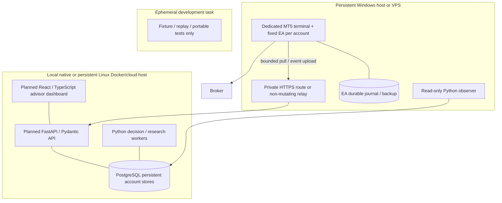

# Fixed EA execution boundary and operating design

Status: **connected design not deployed; bounded M2B native implementation exists**, 2026-11-03. See
[actual M2B scope and evidence](../engineering/m2b-fixed-ea.md). Subordinate to the
[canonical architecture](specification.md) and [ADR-001](../adr/001-fixed-ea-execution.md).
This describes future execution; the current Python gateway remains simulator-only.
No instruction here authorizes changing a terminal, running an order test or restarting
a qualification campaign.

## One decision, from observation to learning

Illustrative EURUSD long; all identifiers below are logical examples, not a trade
or account. USDJPY follows the same account-wide serialization and risk budget.

| Step | Responsible component and authority | Durable evidence | Failure behavior |
| --- | --- | --- | --- |
| 1. Observe at cutoff C | Read-only Python observer plus approved provider collectors; observe, never execute | Snapshot S: native bid/ask and completed bars, event/receipt times, age upper bound and clock uncertainty, account/specification binding, calendar/news versions and health | Connection alive does not imply a current quote. Five-second observer readiness and two-second entry ceiling are distinct. Missing required input blocks affected entries; observer may continue collecting stale evidence |
| 2. Register candidate K | Deterministic B01 scheduler, once per available completed M15 bar, completed H1 context only | Bar identity/cutoff, H1 EMA50 above EMA200, M15 close above preceding 20 highs excluding signal, ATR14, session/DST convention, candidate/version/hash | Missing bars, warm-up or late arrival yields recorded HOLD; no catch-up entry after the 60-second signal window |
| 3. Select K or HOLD | Bounded Python decision worker selects registered candidates or permitted close/tighten proposals; cannot size or route to accounts | Decision D, exact S/K references, model/prompt, qualified lessons available by C, response or failure, rationale, latency/usage/cost | Invalid, injected, late, unavailable or over-budget output becomes HOLD for entries. No arbitrary news-only trade; deterministic position protection continues |
| 4. Validate and reserve | Backend deterministic policy, account-wide transaction; authorize an upper bound only | Risk evaluation R, account/policy/version, limits/reason codes, reservation Z, authorized work W with payload digest and expiry | Reject wrong identity/reference, stale health/conversion, excess budget or conflicting state. Unknown work retains reservation. Model account fields cannot select a dispatch route |
| 5. Receive and preflight | Account-bound fixed EA pulls W; independently verify identity, policy/release, current account, quote, session, specs, ownership, risk and size | Durable local receipt of W/Z/hash; current state and preflight result; SUBMITTING with exact request committed before OrderSend | Reduce volume within Z or veto; never enlarge allowance. Entry quote >2 seconds, unverified age/clock, policy disagreement, missing journal or expired work means no send |
| 6. Execute and protect | EA is sole application writer across symbols and admin commands; broker determines actual execution | Separate request/order/deal/position IDs, return codes, fills/partials, actual volume/price/cost, protection verification and submission-to-protection timing | Acceptance is not a fill. Lost response → OUTCOME_UNKNOWN; no blind resend. Missing SL → PROTECTION_PENDING; block entries, bounded repair/controlled exit subject to fresh ownership and uncertainty |
| 7. Reconcile and exit | EA queries broker evidence and publishes stable events; backend mirrors and reconciles reservations | Event sequence, observed broker state, verified stop, remaining reservation, actual exit and costs; superseding correction if needed | Empty history is not proof of no execution. Retain risk/slot until positive resolution. Stops/closure may be unavailable during disconnect; never report flat merely because flatten was requested |
| 8. Explain | Bilingual advisor uses typed account-scoped reads and deterministic figures | Answer with account, as-of time, S/K/D/R/W/event links; original rationale distinguished from later interpretation | Missing evidence is labeled unknown. Advisor outage cannot stop EA protection or authenticated deterministic pause/flatten controls |
| 9. Learn and evaluate | Research creates hypotheses/regressions; release controller promotes only qualified compatible artifacts | Separate operational/policy/economic labels, net outcome including costs, counterexamples, experiment IDs, chronological evaluations and activation time | A loss does not justify changing risk or code. Failed experiments/HOLDs remain. Future lessons cannot enter historical cutoffs; no runtime self-edit or automatic capital increase |

The entry initially requests a stop at 1.5× completed-M15 ATR14, target 2R and
exit after 16 completed M15 bars or the earlier qualified session/rollover/week
cutoff. Those are B01 rules, not claims of profitability. Fill prices, spread,
slippage, commission and financing determine actual net results.

## Protocol and storage ownership

The [M2C safety implementation](../engineering/m2c-deterministic-safety.md) supplies read-only
preflight, independent native arithmetic, loss/protection reducers and local
durability/fencing reference checks. Production authenticated transport, actual
broker snapshot construction and a connected sender remain gated. Its local
SQLite reference does not replace the PostgreSQL ownership specified below.
The [shadow transport implementation](../history/m2d-shadow-transport.md) supplies a separate
PostgreSQL no-order journal, HTTPS application boundary, compiled native client
and durable receipts. Native HTTPS and actual broker snapshot/clock sourcing are
not qualified; the shadow result cannot be routed to the execution gateway.

Transport is **EA-initiated pull of prepared work**, followed by idempotent event
upload. A private authenticated HTTPS endpoint is pinned per account; a local relay
may carry bytes but has no broker credentials or mutation authority. Distinct
PAPER/LIVE identities, replay protection, bounded payloads and request deadlines
are mandatory. Provider/model keys remain in the backend. TLS peer/identity failure
closes dispatch, never falls back to unauthenticated local HTTP.

| Versioned message | Producer → consumer | Required contents | Durable owner and replay rule |
| --- | --- | --- | --- |
| DecisionIntent (formerly StrategyProposal) | Decision worker → backend | Protocol/intent/decision IDs, trusted account context, strategy/policy version, cutoff and expiry, eligible candidate and evidence, action/symbol/side, entry bounds, stop/target/holding rules; owned position and expected state for management | PostgreSQL decision journal; HOLD produces no broker work. Same identity/different content rejected |
| ExecutionRequest (formerly AuthorizedWork) | Backend → pinned EA | Proposal digest, immutable environment/venue/account binding, release/policy digests, reservation ID, maximum size/risk, health/snapshot/version and expiry, authenticated route, payload hash | PostgreSQL reservation/work plus EA durable inbox. Same reservation counted once across replicas, not two risk allowances. EA returns prior status on duplicate, rejects hash conflict |
| ExecutionAck / ExecutionState / ReconciliationResult | EA → backend | Versioned execution-event subtypes: receipt/acceptance, lifecycle state and reconciliation evidence respectively; immutable event ID, account/request/reservation, monotonic sequence, EA build/policy, UTC and broker time basis, request/retcode and separate broker IDs, requested/filled amounts, protection/exposure/reason and causal predecessor | EA journal before broker call; PostgreSQL append-only mirror with unique event identity/hash. Ack never proves fill. Redelivery after upload loss does not re-send order or double-count fill; gap/conflict blocks readiness |
| EAHealth | EA → backend | Pinned identity/build/login/server/mode, capability/spec hash, tick ages/clock basis, journal cursor, unresolved requests/owned positions/stops and health expiry | Local journal and scoped backend health history. Receipt alone cannot renew quote age, source coverage or an old risk snapshot |
| AdministrativeRequest | Authenticated command router → backend → EA | Actor, conversation/message/request, explicit account/action/position, expected state, expiry and deduplication identity; policy-checked work wrapper | Account journal, EA inbox and execution events. Read/chat history replay cannot execute commands; unknown outcome is not completion |

Wire money, price and volume use explicit decimal strings/units; IDs, canonical
serialization and hash algorithm are protocol-versioned. UTC instants include
offset/precision; retain broker clock provenance separately. Unknown versions,
nonfinite values, floating-point financial input, unknown fields/actions,
incoherent symbol/currency, mixed account namespaces and invalid references fail
closed. A capability handshake must prove compatible protocol, EA artifact and
policy before any entry work is admitted. UTC TTL checks require bounded clock
uncertainty; monotonic timers bound local durations. Neither clock adjustment nor
payload retransmission extends an expiry.

### Facts, replicas and disagreement

| Fact | Authority | On disagreement |
| --- | --- | --- |
| Intent, evidence cutoff and eligibility | Backend append-only decision/authorization journal | No EA inference or provider substitution; reject stale/missing authenticated health |
| Actual fill, position and accepted stop | Broker evidence reconciled by EA | Update mirrored ledger with superseding events; retain uncertainty until resolved |
| Hard policy/capital allocation | Approved immutable release/mandate, independently pinned by backend and EA | Neither may broaden it; mismatch blocks entries |
| Reservation | Backend allocates stable Z; EA records consumption and unresolved remainder | Shared identity prevents double counting; use conservative unresolved exposure until mirrors agree |
| Cash flows and loss baselines | Durable account risk ledger, validated against broker; EA durable copy for protection | Do not reset at restart/deposit/release/demo rollover; unknown flow or conflicting baseline blocks entries |
| Ownership and management rules | Originating intent/release plus broker match | Unknown/external positions are not adopted or liquidated automatically |

### Lost acknowledgment and restart

```mermaid
sequenceDiagram
    participant P as Python backend
    participant D as PostgreSQL
    participant E as Fixed EA + durable journal
    participant B as Broker
    P->>D: Commit reservation Z and work W/hash
    E->>P: Authenticated pull, account + cursor
    P-->>E: W with TTL and maximum risk
    E->>E: Validate / persist W / fresh preflight
    E->>E: Commit SUBMITTING + exact request
    E->>B: OrderSend once
    B->>B: Fill (possible)
    Note over E,B: Response lost or terminal crashes
    E->>E: Restart in STARTUP_RECONCILE, retain Z
    E->>B: Read orders, deals, positions and stops
    B-->>E: Positive matched fill evidence, or unresolved
    alt Positive fill evidence
        E->>E: Verify protection; bounded repair if missing
        E->>P: Stable execution/protection events
        P->>D: Idempotent append and reconcile Z
    else No conclusive evidence
        E->>P: OUTCOME_UNKNOWN; preserve risk
        Note over P,E: Block entries; no replacement send
    end
```

Lifecycle: CREATED → VALIDATED → RESERVED → SUBMITTING → ACKNOWLEDGED /
PARTIALLY_FILLED / FILLED → PROTECTION_PENDING or PROTECTED → COMPLETED, with
explicit REJECTED, CANCELLED and OUTCOME_UNKNOWN branches. Protection pending
also applies to partial exposure. A partial fill consumes actual exposure plus
the reserved unfilled remainder; it does not create a second full reservation.
Cancellation, stop modification and close have the same uncertain-send discipline.

### Terminal scheduling and protection

`WebRequest` is synchronous, requires a configured URL allowlist and is unavailable
in Strategy Tester. `OnTimer` does not make the blocking call asynchronous.
Keep transport short and bounded, never run inference or source searches in EA
callbacks, and measure worst-case delay to protection under timeout and load.
If the measured delay exceeds the predeclared protection budget, this design's
inline transport is not deployable: qualify a separately isolated transport
worker before connected execution. Tester uses file/in-memory fixtures.
[Official WebRequest reference](https://www.mql5.com/en/docs/network/webrequest).

OrderSend success does not prove a fill. Trade-transaction arrival order is not
guaranteed; handlers must remain short and reconstruct state from broker queries,
not presume callback sequence. Test duplicate/delayed callbacks and journal gaps.
[OrderSend](https://www.mql5.com/en/docs/trading/ordersend),
[OnTradeTransaction](https://www.mql5.com/en/docs/event_handlers/ontradetransaction).

Prefer initial broker SL, verify after every partial/full fill and netting change.
Retain a separately broker-qualified fill-then-protect mode; never remove SL and
retry an unexplained rejection. Predeclare submission-to-protection, repair,
controlled-exit and escalation deadlines from measured broker/host evidence.
The existing simulator's five-second timer is **not** that qualification. Missing
protection blocks all new entries; failed/uncertain repair follows reconciliation,
not repeated closes. Test stop/freeze levels, tick/lot rounding, fill modes,
hedging/netting and closed markets for each target binding. Server stops remain
distinct from terminal-managed exits and cannot guarantee a gap-free fill.

## Action matrix and precedence

All allowed management below requires current ownership, remaining volume,
fresh applicable broker state and no conflicting uncertain mutation. A reduction
or close cannot reverse a net position or open another hedge. No widening/removing
SL, averaging down, grids, martingale or risk increase is permitted. State
restrictions compose: the most restrictive gate wins. Owner entry-pause is an
independent persisted flag, not a replacement for risk/integrity states.
The roadmap's `PAUSED` is this owner entry-pause flag, not a new state that can
overwrite LOSS_PAUSE, PROTECTION_PENDING, OUTCOME_UNKNOWN or HARD_HALT.

| State | ENTER | CANCEL risk-increasing pending | TIGHTEN_STOP | REDUCE/CLOSE owned | RESUME_ENTRIES | Escalation / resolution |
| --- | --- | --- | --- | --- | --- | --- |
| STARTUP_RECONCILE | No | Only after relevant order reconciled | Only after position reconciled | Only after position reconciled | Clear owner flag only after reconciliation; other gates remain | Rebuild broker/journals/baselines; unknowns stay blocked |
| RUNNING | All checks and no owner pause | Yes | Yes, never widen | Yes | Clear owner pause only | Any breached gate changes effective state |
| DEGRADED_PROTECT | No | If broker state known | If needed evidence/current quote available | Controlled exit if executable | Does not clear degraded state | Recover required inputs and newly valid snapshot |
| OUTCOME_UNKNOWN | No account-wide | No conflicting mutation | No conflicting mutation | Only independently reconciled positions; never repeat uncertain action | Does not clear unknown | Positive evidence or explicit reviewed resolution; no timeout-based assumption |
| PROTECTION_PENDING | No account-wide | Known pending orders only | Bounded attach/repair and verify | Bounded reduce/exit when protection cannot be restored | Does not clear pending | Deadline violation escalates persistent halt; unresolved outcome retained |
| LOSS_PAUSE | No | Attempt bounded cancellation | Feasible protection while exiting | Attempt controlled closure | Cannot clear loss pause | Next UTC risk day only if reconciled and no persistent halt |
| HARD_HALT | No | Known orders only | Feasible protection | Feasible controlled closure | Cannot clear hard halt | Separate mandate/release remediation, never model override |

With backend/DB failure, block entries. Only a tested EA-local durable emergency
path may manage reconciled owned positions; persist before submission and replay
on recovery. If local storage also fails, do not claim a mutation is durably
recorded or safely repeatable; alert and preserve existing server protection.
With total broker/terminal disconnect, server stops may remain but terminal
management/closure is unavailable. Display open/unknown, not safe/flat.

Pause and flatten commands are serialized with entries at the backend and EA.
An already submitted order must be reconciled; receipt by the web service does
not prove the EA has applied a pause. Flatten first persists the entry halt, then
cancels/closes owned exposure and reports each broker-confirmed result.

## Deployment, release and restore runbook design



1. **Provision separately:** PAPER/SIMULATOR, PAPER/BROKER_DEMO and LIVE/BROKER_LIVE
   have separate database roles/namespaces, credentials, account bindings, terminal
   directories and EA/policy releases. The endpoint allowlist and private firewall
   expose only the account route. Container `localhost` is not the Windows host;
   configure an authenticated private host route explicitly. Never bundle secrets
   or runtime state in images. CMC remains first, FOREX an independent comparison,
   never automatic failover.
2. **Before enabling entries:** verify artifact hashes/compiler/terminal build,
   identity/permissions/account capabilities, clock bounds, required-source health,
   single writer, durable journals, broker reconciliation, loss baselines and
   confirmed protection. All P0/M1 and applicable release gates must be satisfied;
   a documentation merge or simulated pass is not authorization.
3. **Supervise:** monitor terminal, EA heartbeat, source ages, journal sequence/disk,
   DB, network and build changes independently. Reconnect uses bounded backoff and
   STARTUP_RECONCILE; automatic process replacement must not create a second
   account writer. No host-clock changes during qualification campaigns.
4. **Release:** verify compatible source/EX5/compiler/terminal/protocol/policy/
   strategy/model/prompt/provider/lesson manifest. A separate controller may deploy
   only an exactly qualified release inside a preauthorized capped LIVE mandate.
   Otherwise LIVE stays off. PAPER decisions/orders/balances/loss history never
   seed LIVE state. Runtime models cannot invoke the controller.
5. **Move/restore/rollback:** block entries, drain work and reconcile; fence the
   old host/terminal before replacement. Restore PostgreSQL and the matching EA
   journal with identity/hashes and unresolved reservations intact. Reconcile
   broker changes since backup before resuming. Missing journal or uncertain old
   writer blocks the replacement. Open positions retain originating exit rules
   under the known compatible artifact until qualified handoff/closure; rollback
   cannot reset losses, adopt unrelated holdings or forget positions.
6. **Demo expiry:** track the existing estimated 90-day FOREX deadline and warn
   early; no assumption of renewed accounts/permission. Drain, reconcile, archive,
   fence the old EA and provision a new immutable binding. Keep failed campaign
   history and evidence gaps; a fresh virtual balance is not economic profit,
   reset loss authority or completion of a previous run.

Native local development and persistent Docker core use the same domain/storage
contracts. Native Windows compiler/Tester validation is a separate stage; ephemeral
cloud coding environments run fixtures/replay only, with no LIVE credentials or
endpoints. Broker-demo access requires separately provisioned authorization.
The existing [M0C transfer procedure](../history/m0c.md) proves offline archive behavior only;
it does not back up or fence a future execution EA.


### Consolidated disabled integration

The [M2 disabled-integration report](../history/m2-disabled-integration.md) records the composed
operating-input, durable loss/protection veto, account-fenced native assessment and
receipt/checkpoint path. No order sender is available in that native host. The
original FixedGateway remains Tester-only; actual demo execution integration and
acceptance remain explicit M2D gates. Native assessment, source integrity and a
transport ACK are not provider qualification or broker execution evidence.
