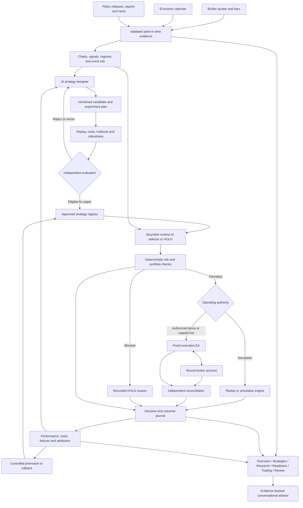

# AI-led trading lifecycle

The product optimizes for a validated trading edge and reliable execution, not a
demonstration. Start with EURUSD/USDJPY, one execution broker and one active approved
version. [R0-R6 and UI acceptance](../product/roadmap.md) define delivery order.

## One decision: authority, evidence and failure

| Step | Component and authority | Evidence | Failure behavior |
| --- | --- | --- | --- |
| Observe | Observer/provider adapters read only; input validation admits data | Native/source/receipt/availability times, identity, revisions and coverage | Unknown time or missing required inputs blocks entry. Health is not freshness. Never refresh source timestamps to appear current. |
| Design | AI researcher proposes a hypothesis and rules in isolation | Candidate version, parent, model/prompt/input hashes and requested changes | Invalid or unsupported rules stay drafts. Generated code cannot run in production without validation/review. |
| Select | Bounded selector uses only registered eligible setups, or HOLD | Exact strategy version, context cutoff, proposal, usage and rationale | Malformed/late/unsupported replies become HOLD; uncertain calls are not blindly resent. PR #63 reservations survive restart. |
| Risk | Deterministic engine alone admits exposure | Account, quote-age checks, policy version, sizing, reservations and USD exposure | Veto on missing coverage, stale quotes, loss/margin/exposure limits. AI/UI cannot widen ceilings. |
| Execute | Fixed EA independently validates authorized account and intent | Native attempt, request ID, protection, broker response | No blind resend after uncertain submission. Reject wrong identity; protective management continues independently of AI. |
| Reconcile | Broker is authoritative for actual orders/deals/positions | Broker witnesses, ownership, protection, ACKs and unresolved differences | Block new entries on unresolved state; preserve and manage owned risk. Flatness alone does not prove closure. |
| Explain | Advisor reads scoped evidence; no execution or promotion authority | Citations to candidate/decision/trade/report and explanation version | Say unknown when evidence is missing; do not invent fills, causes or profitable outcomes. |
| Learn | Evaluator measures; AI proposes a challenger | Costs, drawdown, attribution, failed experiments, comparison and promotion record | New version repeats validation. No silent changes to active strategy, risk or exposed holdout. |

## Strategy and experiment contracts

A candidate must describe hypothesis, pairs/sessions, point-in-time inputs, feature
definitions, executable entry/exit/HOLD rules and percentage risk. Portfolio controls
include total open risk and signed aggregate USD exposure across both pairs. Candidate
preferences cannot exceed the separately approved account mandate. Preserve the
two-second original/native quote ceiling and verified clock bounds.

A descriptive draft is not executable. Freezing records exact content for research;
it does not attest rule correctness, data quality, profitability or paper/live eligibility.
R1 completion requires a reviewed executable mapping and authenticated AI generation
with retained model/prompt/input provenance, not a template presented as an AI result.

Before R2 testing, pin candidate/code/model/prompt/dataset hashes, availability and
revision rules, development/walk-forward/untouched holdout intervals, base/stress costs,
benchmarks, sample/uncertainty requirements and rejection criteria. Compare deterministic,
AI and news contributions when applicable. Missing historical reports cannot be filled
using future knowledge. Exposed holdouts cannot be reused for tuning and then described
as independent validation. Net outcomes include model and trading costs where applicable.

## Promotion and operating boundary

Historical acceptance permits considering demo readiness, not immediate orders.
R3 requires applicable source and execution gates. R4 uses a separately authorized
frozen prospective plan. The existing unattended floor remains eight weeks AND 100
closed trades plus economic/operational criteria; insufficient evidence remains such.
R5 requires separately authorized live account, percentage limits and verified release.
R6 cannot authorize itself, refund consumed mandates, increase risk or rewrite prior results.

The UI exposes backend-validated lifecycle transitions and citations. Viewing accounts
never changes command destinations. Progress/error/restart/export paths are part of
each milestone's acceptance, with clear synthetic/recorded/simulation/demo/live labels.
This implementation begins with offline research records. It adds no broker capability.
