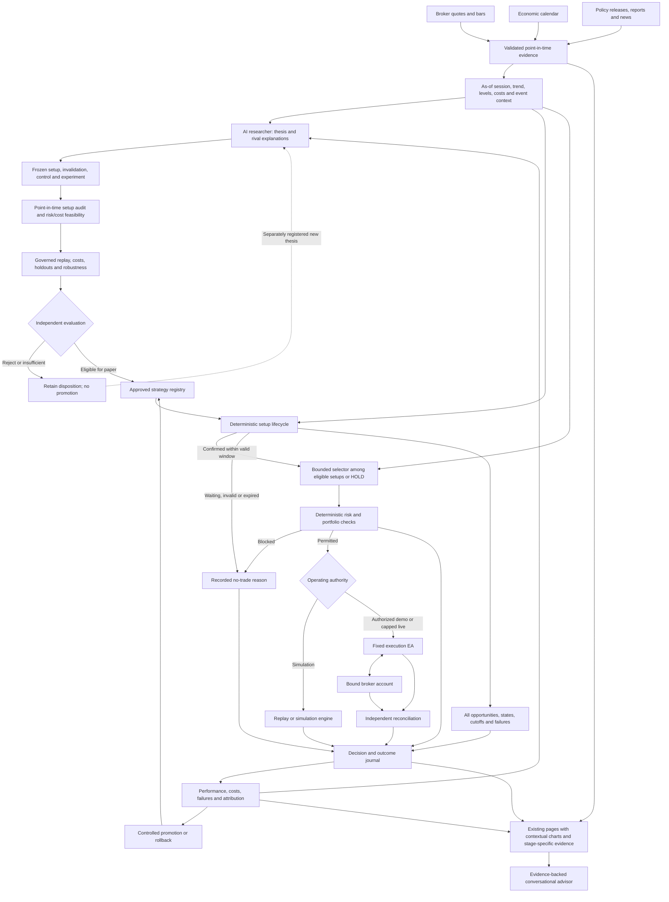

# AI-led trading lifecycle

The product seeks a validated trading edge with reliable execution. Start with
EURUSD/USDJPY, one execution broker and one approved active version. The November 18
[R0-R6 revision and UI acceptance](../product/roadmap.md) puts observable market
setups before implementation: context, known level, ordered price response,
confirmation and invalidation must be explicit. AI proposes and explains; reviewed
deterministic rules recognize eligible setups and enforce the account mandate.

This is the target design. Existing code supports H1/M15 indicator kernels, session
filters and replay, not structural pullback/retest sequences or annotated setup
charts. Trading stays disabled; no campaign or deployment follows this update.

## One decision: authority, evidence and failure

| Step | Component and authority | Evidence | Failure behavior |
| --- | --- | --- | --- |
| Observe | Observer/provider adapters read only; input validation admits data | Native/source/receipt/availability times, identity, revisions and coverage | Unknown time or missing required inputs blocks entry. Health is not freshness. Never refresh source timestamps to appear current. |
| Design | AI researcher proposes a falsifiable setup and bounded comparison | Candidate/parent, known-level derivation, price-response sequence, invalidation, input/model/prompt hashes, costs and rival explanation | Unsupported rules stay drafts. Later prices/news cannot supply historical knowledge. Generated code cannot enter production without review/validation. |
| Recognize (planned extension) | Versioned deterministic rules advance a registered setup using then-available observations | Stable setup ID, level first-known time, closed-bar cutoff, transitions, expiry and all no-trade reasons | Missing data blocks; expired/broken setups retire. Same event cannot retrigger after restart. A model cannot invent a retest or confirmation. |
| Select | Bounded selector may rank/veto confirmed eligible setups or HOLD; it cannot create eligibility | Exact strategy/setup IDs, context cutoff, proposal, usage and rationale | Malformed/late/unsupported replies become HOLD; uncertain calls are not blindly resent. PR #63 reservations survive restart. |
| Risk | Deterministic engine alone admits exposure | Account, quote-age checks, policy version, sizing, reservations and USD exposure | Veto on missing coverage, stale quotes, loss/margin/exposure limits. AI/UI cannot widen ceilings. |
| Execute | Fixed EA independently validates authorized account and intent | Native attempt, request ID, protection, broker response | No blind resend after uncertain submission. Reject wrong identity; protective management continues independently of AI. |
| Reconcile | Broker is authoritative for actual orders/deals/positions | Broker witnesses, ownership, protection, ACKs and unresolved differences | Block new entries on unresolved state; preserve and manage owned risk. Flatness alone does not prove closure. |
| Explain | Advisor reads scoped evidence; no execution or promotion authority | Citations to candidate/decision/trade/report and explanation version | Say unknown when evidence is missing; do not invent fills, causes or profitable outcomes. |
| Learn | Evaluator measures; AI proposes a challenger addressing an observed cause | Non-entries, net expectancy, uncertainty, costs, drawdown, adverse/favorable excursions, session attribution, failures and promotion record | Repeat validation; do not optimize the same period until it passes or silently change active rules/risk. Retain rejected and data-gated ideas. |

## Strategy and experiment contracts

A candidate must describe hypothesis, pairs/sessions, point-in-time inputs, feature
definitions, executable entry/exit/HOLD rules and percentage risk. Portfolio controls
include total open risk and signed aggregate USD exposure across both pairs. Candidate
preferences cannot exceed the separately approved account mandate. Preserve the
two-second original/native quote ceiling and verified clock bounds.

Structural setups freeze level derivation/first-known time, tolerance, confirmation
delay, maximum waiting time, invalidation and exit. Only completed H1/M15 bars can
confirm the first proposed family. A pivot requiring later bars becomes available
after those bars, never backward in time. Broken/expired levels require a new setup,
not an altered record. Candle contraction does not prove order flow or an edge.

Setup recognition is separate from an execution request. Confirmation can still be
vetoed by costs, calendar, quote age, authority or risk. The fixed-target research
variant needs the restrictive
[lifecycle sizing bound](../product/trading-research-assessment.md#resolve-the-strategyrisk-conflict)
before governed comparisons. Preserve caps, giveback semantics and persistent halts.
Partial/trailing exits need their own proof; an unbounded target cannot reuse a
finite-target exposure envelope.

A descriptive draft is not executable. Freezing records exact content for research;
it does not attest rule correctness, data quality, profitability or paper/live eligibility.
R1 completion requires a reviewed executable mapping and authenticated AI generation
with retained model/prompt/input provenance, not a template presented as an AI result.
It also needs a chart audit proving recognized opportunities match the frozen setup
without future data. An EMA recross/breakout does not satisfy the structural contract
merely because its name resembles the new hypothesis.

Before R2 testing, pin candidate/code/model/prompt/dataset hashes, availability and
revision rules, development/walk-forward/untouched holdout intervals, base/stress costs,
benchmarks, sample/uncertainty requirements and rejection criteria. Compare deterministic,
AI and news contributions when applicable. Missing historical reports cannot be filled
using future knowledge. Exposed holdouts cannot be reused for tuning and then described
as independent validation. Net outcomes include model and trading costs where applicable.

The opportunity ledger includes watched, confirmed, invalidated and expired setups
plus governance vetoes. Diagnostic counterfactuals stay separate from governed P&L.
Compare one primary rule with its predeclared control before adding filters or exit
variants. Candidate-required historical event/cost checks precede any economic pass;
production reliability remains an additional R3 gate. REJECT and INSUFFICIENT_EVIDENCE
finish a study without granting promotion or automatically extending the experiment.

## Promotion and operating boundary

Development-state schema compatibility is not a release prerequisite before actual
strategy PAPER/LIVE data exists. Recreate disposable development stores instead of
building legacy data migrations. Preserve qualification reports, failures and retained
research evidence. Current-version restart and idempotency remain necessary. Establish
protected operational storage and upgrade/rollback policy before R4/R5 activation.

Historical acceptance permits considering demo readiness, not immediate orders.
R3 requires applicable source and execution gates. R4 uses a separately authorized
frozen prospective plan. The existing unattended floor remains eight weeks AND 100
closed trades plus economic/operational criteria; insufficient evidence remains such.
R5 requires separately authorized live account, percentage limits and verified release.
R6 cannot authorize itself, refund consumed mandates, increase risk or rewrite prior results.

The UI exposes backend-validated lifecycle transitions and citations. Viewing accounts
never changes command destinations. Progress/error/restart/export paths are part of
each milestone's acceptance, with clear synthetic/recorded/simulation/demo/live labels.
This implementation begins with offline research records. It adds no broker capability.
