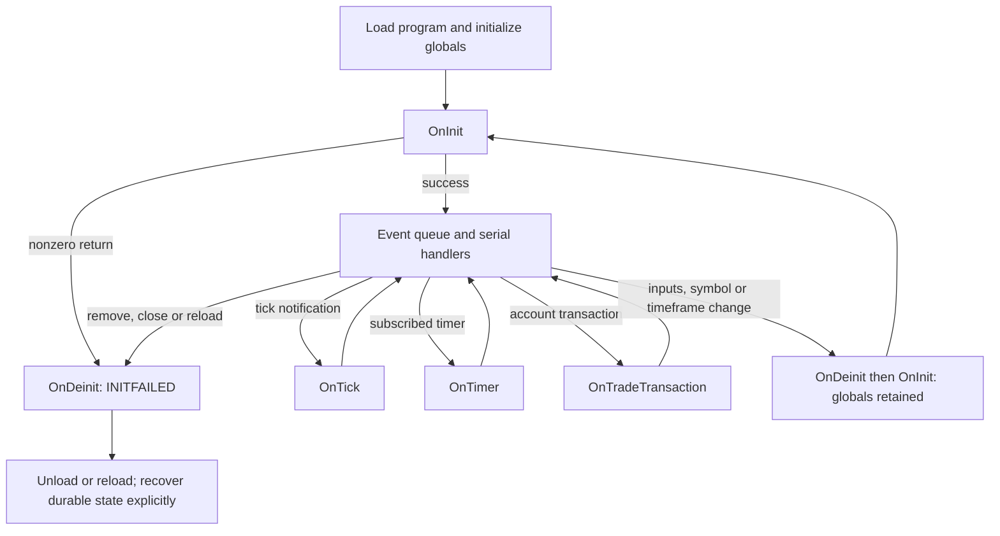

# EA event lifecycle review

November 4, 2026. Source review of the read-only quote publisher, connected
diagnostic EA, Tester-only gateway, and their evidence. No terminal lifecycle
experiment or new campaign was started for this review. See the companion
[quote-freshness review](ea-quote-freshness-review.md) for timestamp boundaries.
Trading remains disabled, the two-second entry ceiling is unchanged, and the
original attempts remain incomplete. Findings below are source-derived unless
explicitly identified as actual run evidence; they are not claimed runtime reproductions.

## Event and state model

An EA's handlers are serial within that EA. Different EAs have separate threads;
moving work into the same EA's timer does not make it concurrent. MetaQuotes'
[runtime model](https://www.mql5.com/en/docs/runtime/running) describes both the
per-program queues and finite-queue discard behavior. Source tick history, latest
quote cache, queued events and application buffers are different layers.

The diagram is about normal lifecycle processing. A crash or forced process exit
does not supply a reliable cleanup receipt. `ExpertRemove()` sets a removal flag;
the current handler must still return. See
[ExpertRemove](https://www.mql5.com/en/docs/common/expertremove).

| Event or condition | Platform behavior | Required interpretation |
| --- | --- | --- |
| First load | Globals/objects initialize, then `OnInit`; nonzero `int OnInit` means failure and `REASON_INITFAILED` cleanup | Publish readiness only after binding, storage and timer setup succeed. [OnInit](https://www.mql5.com/en/docs/event_handlers/oninit) |
| Inputs, symbol or timeframe change | `OnDeinit`/`OnInit` run without a full EA reload; globals/statics survive | Reset transient state deliberately and recover durable state deliberately; neither is automatic. [Lifecycle](https://www.mql5.com/en/book/applications/runtime/runtime_lifecycle) |
| Events arriving before initialization finishes | Skipped for the EA | An initial snapshot is useful, but cannot recover original delivery times or prove nothing was missed. [Lifecycle](https://www.mql5.com/en/book/applications/runtime/runtime_lifecycle) |
| New tick for attached symbol | `OnTick` notification; another NewTick is not added while one is queued/processing | Latest-state sampling is possible; callback count is not total tick count. [OnTick](https://www.mql5.com/en/docs/event_handlers/ontick) |
| Tick for another symbol | Does not generate this chart EA's `OnTick` | Use explicit per-symbol observation/subscription design; querying another symbol is not subscribing to its callbacks. [OnTick](https://www.mql5.com/en/docs/event_handlers/ontick) |
| Timer period elapses | Only after timer creation succeeds; one timer per program; Timer events coalesce | Period is not a handler deadline. Use elapsed time, not callback counts, for expiry. [OnTimer](https://www.mql5.com/en/docs/event_handlers/ontimer) |
| Slow handler | Blocks other handlers in that EA; queueing/coalescing continue | A synchronous request or file flush in `OnTimer` can still delay that EA's tick handling. [WebRequest](https://www.mql5.com/en/docs/network/webrequest) |
| Trade transaction | Manual operations, requests, stops/pending activation and server operations can generate it; ordering is not guaranteed | Treat it as a reconciliation trigger, not an authoritative fill ledger. The transaction queue holds 1,024 entries and can supersede older entries under overload. [OnTradeTransaction](https://www.mql5.com/en/docs/event_handlers/ontradetransaction) |
| `OnTrade` | No one-request/one-callback correspondence | Never infer exactly-once completion from notification counts. [OnTrade](https://www.mql5.com/en/docs/event_handlers/ontrade) |
| Algo Trading disabled | Tick notifications and EA computation continue; trade submission permission is disabled | Our read-only identity guard intentionally additionally requires Algo Trading off. The permission switch is not an EA pause button. [Runtime events](https://www.mql5.com/en/docs/runtime/event_fire) |
| Account activation, recompilation, template/profile/chart/terminal changes | Different reload/deinitialization reasons apply | Record reason and revalidate binding. Do not assume every ordinary network interruption is a full reload. [Deinit reasons](https://www.mql5.com/en/docs/event_handlers/ondeinit) |
| Normal deinitialization | Cleanup is limited to 2.5 seconds | Critical records must already be durable. Missing final markers mean incomplete evidence, not successful shutdown. [Runtime events](https://www.mql5.com/en/docs/runtime/event_fire) |

## Concrete findings

### 1. Quote publisher does not establish a new lifecycle state

`QuoteStream.mq5` initializes `head`, `count`, `sequence`, `dropped`, `stopping`
and the output handle globally, but `OnInit` does not reset them. With an Inputs
change to a new RunToken, the new output file can start above sequence 1;
`observer.quote_stream.Tail` requires sequence 1 for a new file and rejects it.
The documented retained-global behavior makes this a source-derived defect.
Relevant code: [publisher](../mql5/readonly/QuoteStream.mq5#L13),
[initialization](../mql5/readonly/QuoteStream.mq5#L51),
[consumer](../src/fx_talanta/observer/quote_stream.py#L87).

Changing timeframe without changing RunToken instead encounters the existing-file
refusal. This preserves the old artifact but stops continuity; it is not an
automatic resumed stream. `OnDeinit` correctly closes and invalidates the output
handle. Define an explicit new-stream versus resume policy, reset transient
state, and record lifecycle identity/reason. Never reset an authoritative journal
sequence merely to make a consumer accept a new lifecycle.

The connected EA also retains clock, backoff, due-time and diagnostic state across
warm reinitialization unless explicitly reset. Its inbox recovery has its own
rules; those do not prove safe reuse of the transient clock/transport state.
Use a fresh clock qualification after reinit and an explicit durable inbox/session
policy, rather than relying on a global object's constructor being called again.
The connected timer also checks its backoff due time before its identity/trading
guard. During a 30-second backoff, guard-change detection can be delayed until
the next attempt. This EA has no order API; a future executor must keep safety
checks independent of communication backoff.

### 2. Drop accounting does not measure tick completeness

The publisher's `dropped` counter increases only when its own 1,024-slot buffer is
full. It does not count NewTick coalescing, initialization-time skipped events,
failed `SymbolInfoTick` reads or buffers discarded after I/O failure. A contiguous
CSV sequence and zero buffer drops establish continuity of emitted records only.
The stored capture counter begins inside the handler, not at network receipt.

Keep separate counters/reasons for emitted samples, application overflow, read
errors, lifecycle gaps and consumer discontinuity. Label unobservable terminal
event coalescing as unmeasured. If complete available tick history is required,
reconcile with `CopyTicks` outside the entry-critical path; that does not restore
the original arrival timestamps. [CopyTicks](https://www.mql5.com/en/docs/series/copyticks)

### 3. Shutdown draining has no time budget

The publisher's [OnDeinit](../mql5/readonly/QuoteStream.mq5#L92) drains the entire
remaining buffer, including synchronous flushes, before its STOP record. Slow I/O
can consume the platform's cleanup allowance and leave no final STOP. There is
also no distinction among deinit reasons in that record. Its timer's duration
check is a cooperative stop check, not a hard deadline while a handler is blocked.
The duration check runs only at timer entry: a slow drain can cross it, and a
subsequent tick can capture a sample before the next timer checks again.
Bound cleanup, retain explicit unfinished state, and verify completion from
durable evidence. Do not interpret absence of a STOP as a clean empty tail.

### 4. Gateway initialization ignores timer failure

[FixedGateway.OnInit](../mql5/gateway/FixedGateway.mq5#L19) ignores the boolean from
`EventSetTimer(1)` and returns success. If creation fails, tick processing may
continue without no-tick reconciliation/telemetry. Check failure and close opened
resources before returning initialization failure.
[EventSetTimer](https://www.mql5.com/en/docs/eventfunctions/eventsettimer)

### 5. Failed reconciliation loses its retry trigger

[FixedGateway.OnTimer](../mql5/gateway/FixedGateway.mq5#L35) clears
`reconcile_needed` unconditionally. [FxReconcile](../mql5/gateway/Broker.mqh#L146)
can return immediately on `HistorySelect` failure. Without another tick or
transaction notification, subsequent timers do not retry. Return an explicit
outcome, retain the dirty state after incomplete reads, and schedule bounded
periodic reconciliation independently of event delivery.

### 6. Protective management has no tick-independent runtime path

The fixture gateway consumes all work only in
[OnTick](../mql5/gateway/FixedGateway.mq5#L41), including CLOSE/CANCEL/TIGHTEN_STOP.
Its timer only reconciles and publishes telemetry. The deterministic `SProtect`
state machine is not called or persisted by that gateway. Without new ticks for
the attached chart symbol, new management work is not consumed. This is an integration gap,
already consistent with the limitations of
[M2C](m2c-deterministic-safety.md), rather than proof that protection runs without
ticks. A future executor needs independent bounded management scheduling and
explicit repair/exit deadlines.

### 7. Reconciliation and recovery are fixture-scoped

`FxReconcile` selects history from time zero and performs nested scans of work,
orders, deals and positions with no per-handler budget. It can delay other events
as history grows. The notification-only `OnTradeTransaction` handler is a good
choice, but does not make the later reconciliation work bounded.

`FxGateway.Open` creates a missing journal implicitly, while the work file is
reopened from its beginning. This cannot establish deployment duplicate protection
after a missing journal or valid-prefix rollback. Explicit bootstrap and retained
checkpoints are required before connected execution. The separate safety store
refuses missing files without explicit bootstrap, but does not itself prove
valid-prefix rollback detection and is not wired into this fixture gateway.
The current sender refuses non-Tester
execution, so these gaps do not expose a deployed order path.

### 8. Existing tests do not prove lifecycle coverage

`GatewayTester` drives its own `OnTick` sequence and counts trade callbacks; it
has no `OnTimer`. Its restart scenario closes/reopens the journal object, not the
terminal EA. The clock/inbox native assertions also test components, not event
coalescing or reinitialization. Preserve those passes, but do not use their counts
to claim coverage of missed callbacks, failed timer creation, quiet-market
protection or cleanup interruption.

The EA/Python comparison has a separate measurement defect: EA receipt is timed
in the parent after file parsing, while polling receipt is timed in the SDK child
before IPC and parent ingestion. Cache initialization differs too. Its matched
delta is not an equal-boundary latency comparison. Keep the original observations
but qualify their interpretation; align both measurement endpoints and warmup
before asserting which channel is faster.
The comparison's `collection_seconds` also includes worker teardown; use actual
sample-window timestamps when reporting coverage or cadence.

## Remediation acceptance cases

These are concrete missing cases, not a launch authorization or a requirement
for another 24-hour campaign:

1. Cold start, failed binding/storage/timer setup, Inputs change, symbol/timeframe
   change and full reload: explicit lifecycle state, no stale clock, no reused
   closed handle, no accidental authority or sequence reset.
2. Burst updates during slow processing and initialization: distinguish sampled
   current state, application drops and unknown event coalescing. Heartbeats and
   INITIAL snapshots must never count as new source quotes.
3. Timer lateness or skipped timer callbacks: elapsed deadlines still expire;
   protective management/reconciliation retries continue without ticks.
4. Failed history/position query, reordered/duplicated trade notifications and
   callback overload: query authoritative state, keep unresolved exposure reserved,
   and retry without assuming one notification equals one fill.
5. Slow flush, early remove, failed init cleanup, abrupt exit and missing/truncated/
   rolled-back journal: no false clean-stop claim or duplicate submission.
6. Symmetric EA/Python arrival boundaries, startup cache policy and source-time
   uncertainty: separate measured local lag from source-age qualification.

Use deterministic fault injection for control/state transitions and a separately
specified bounded native event harness for platform behavior. Neither synthetic
component tests nor a long soak alone substitutes for the lifecycle cases above.
No existing failed run is restarted or reclassified by this review.
