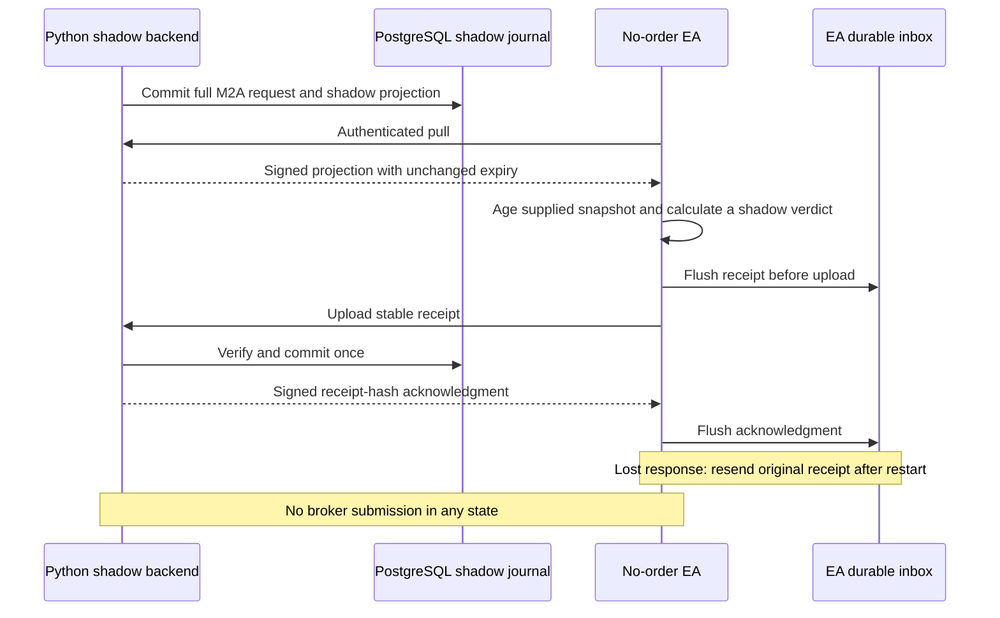

# M2D shadow delivery and durable receipts

This page preserves the initial transport's November 3 scope and evidence.
The separate [bounded connection extension](../engineering/m2d-connected-no-order.md) records
the subsequent real input, clock, authority and recovery work in the same PR.

This increment implements a **no-order transport**, distinct from the M2B Tester
order gateway. The Python backend and new `mql5/shadow/ShadowEA.mq5` exchange
authenticated work projections and shadow receipts. Neither receipt nor merge
enables execution. Connected M2D acceptance and the historical M1 gaps remain open.

## What is implemented

- `shadow/backend.py`: account/release/policy-bound prepared-work publication,
  EA-initiated pull, durable receipt ingestion, and a narrow HTTPS-only WSGI
  application. Publication is a trusted in-process backend API, not a public
  endpoint. Only PAPER identities are accepted; LIVE is rejected.
- `shadow/store.py`: PostgreSQL append-only experiment streams and a local SQLite
  reference store for portable tests. Migration 007 adds a separate evidence
  table; it does not modify earlier migrations or execution/reservation records.
- `shadow/client.py`: reference client with certificate/hostname verification,
  no redirects or HTTP fallback, and a durable receipt outbox.
- `mql5/shadow/`: independently implemented HMAC/frame handling, M2C risk
  calculation, durable native inbox, and bounded HTTPS pull/upload source.
  `EnableShadow=false` by default. No `OrderSend`, `OrderCheck`, `CTrade`, login,
  symbol selection, or management/close action is available on this path.
- `Backend.status()`: separate EA, Python package and MCP channel projections,
  with nullable current quote age/latency and separately labelled historical
  shadow snapshot age. An EA pull is evidence of shadow delivery only. It cannot
  establish broker connectivity, quote freshness, Python health or MCP health.

## Semantics and limits

The backend retains the complete validated M2A `ExecutionRequest` alongside the
native projection. Snapshot hash, symbol, side, currency, stop and maximum
volume/risk must match. This version supports shadow entry analysis only;
management commands reject. It **does not allocate a real risk reservation**.
The original reservation ID is provenance, not a new spendable allowance.

The native calculation uses an authenticated supplied `SafetyInput`. Receipt
validation independently recomputes the result with Python's Decimal governor;
different reason, age or volume rejects. The native receipt is not an
`ExecutionAck`, broker acceptance or fill. An `ACCEPTED` calculation means the
supplied snapshot passed that calculation, not that a current broker order is
eligible. Real snapshot sourcing, loss-baseline reconciliation, costs and broker
protection remain separate qualification gates.

Quote/conversion age advances by elapsed time since the original measurement.
The **two-second entry ceiling is unchanged**; clock uncertainty consumes that
budget. Request expiry and snapshot freshness are independent of transport TTL.
Resending a receipt does not refresh any of them. Expired queued work is delivered
for an explicit expired verdict rather than silently disappearing.

The connected EA source deliberately uses a 1,000 ms local clock-uncertainty
floor because `TimeGMT()` supplies whole seconds and no qualified clock adapter
is wired into it. This cannot pass the existing 100 ms clock gate. It is not
permission to reduce that uncertainty by changing a setting. A qualified native
clock/snapshot adapter is still needed before any actionable connected verdict.
Synthetic native tests supply explicit test clocks, clearly separate from this
operating limitation. No host clock was changed.

### Authentication and failures

Wire domain `shadow/1` authenticates direction, account scope digest, fixed client,
nonce, issuance/expiry, operation and payload with HMAC-SHA256. Requests and
responses have distinct directions; responses bind the request nonce. Frames are
at most 32 KiB; projections at most 4 KiB; transport TTL at most five seconds.
Transport issuance tolerance is two seconds and **never grants quote-age credit**.
Only the exact `/v1/shadow` POST route is accepted. The WSGI application requires
an HTTPS server environment and does not trust forwarded-protocol headers.

Same nonce/content returns the original signed response without changing its
expiry. Changed content under that nonce rejects. Receipt identity binds the
request ID, sequence and projection hash. Conflicting results reject; an identical
receipt is acknowledged without another insertion. Work is processed in sequence,
one pending receipt at a time, with no silent gap skipping.

SQLite serializes local writers. Native file access is exclusive for the EA's
lifetime. PostgreSQL serializes stream transactions and blocks UPDATE/DELETE/
TRUNCATE of its shadow table. These prove local/stream serialization, **not
distributed execution fencing**. A fixed client identity does not replace a
production writer-lease authority.

Missing inbox/binding never silently bootstraps. Bootstrap is explicit for a
new file/stream; an existing native file cannot be reset through bootstrap.
Restart retains both the receipt and its acknowledgment. A backend that redelivers
already acknowledged work is treated as a checkpoint conflict, not new work.
Malformed/truncated journals fail closed. Hash chains detect accidental alteration;
they are not protection against an administrator rewriting the entire database.
Coordinated rollback still requires an independently retained checkpoint.

An unavailable backend/database leaves the local receipt pending. There is no
automatic broker failover. The native client makes one request per timer attempt,
with a 1,500 ms WebRequest timeout and a two-second observed exchange bound;
failure backs off to at most 30 seconds. The Python reference allows one
two-second-bounded exchange per call. External listener read/body/connection
timeouts and worker limits must also be configured at deployment. No inference
runs in the EA callback. WebRequest is synchronous, so these settings do not
qualify execution-protection timing.

Journals stop accepting new events at 10,000 records. This is a bounded development
session, not an unattended service retention policy. Archive version 2 includes
the PostgreSQL shadow table, validates account scope/hash chains, and keeps
restored shadow writers blocked until the existing explicit release/handoff.
Version 1 archives remain readable; restore still requires the matching source
schema/application version. Existing archives are not rewritten. The native
inbox and an independently retained peer checkpoint still need a coordinated
backup/restore procedure before deployment; a database archive alone is not a
complete shadow backup.

## Actual verification

[Committed evidence](../evidence/m2d-shadow-20261103.json) records source hashes,
native compile results and actual independent native outputs:

- Full native-host Python/PostgreSQL regression: **653 passed**, no skips.
  Source hashes use Git LF bytes; separate compiler-input hashes preserve the
  original native build bytes and their identical LF-normalized source.
- 60 native/Python receipt cases, including the existing 56 M2C risk cases,
  the exact two-second boundary, one millisecond beyond it, expiry and unverified
  local clock. These are synthetic snapshots, not observed market data.
- 80 native assertions covering authentication/direction/expiry/nonce,
  exclusive writer, persisted receipt, restart, wrong acknowledgment,
  retained acknowledgment, rollback refusal and binding/bootstrap refusal.
- Both native programs compile with zero errors and zero warnings in a separate
  account-free portable terminal directory. Native runs use mathematical Tester
  mode, no account connection or market orders.
- Python tests exercise a real loopback TLS listener with an ephemeral trusted
  certificate, a response dropped after durable commit, successful receipt
  redelivery and rejection of an untrusted certificate. This is a Python HTTPS
  client exercising the same wire protocol; **native WebRequest against HTTPS
  has not been exercised**. MetaTrader's Tester cannot run WebRequest.
- Dedicated PostgreSQL tests cover durable restart, concurrent duplicate
  publication, account/database mismatch, mutation denial, and an actual failed
  database connection with pending-receipt recovery, plus preservation through
  guarded archive/restore. Broker databases are not used as fixtures.

The two existing broker terminals, private bindings/environments, frozen campaign
checkouts and historical broker/provider evidence were not modified. No campaign,
account change, terminal deployment or broker order was started.

## Reproduce without a broker

Run `python -m pytest tests/test_shadow.py`; add `--integration` only with a
dedicated fixture PostgreSQL namespace. OpenSSL generates an ephemeral loopback
test certificate; no trust-store installation is required. The test listener
shuts down when its test finishes. All production keys remain outside Git.

Export native fixtures with
`python -m tools.fixtures.shadow_fixtures --export <isolated-MQL5-Files-directory>`.
Compile `ShadowEA.mq5` and `NativeTests.mq5` with the adjacent includes; run the
latter only in a separate account-free mathematical Tester. Compare actual output
using `python -m tools.fixtures.shadow_fixtures --compare <tester-output> --output <report>`.
Never overwrite an older evidence directory or reuse a broker terminal for this.

## Remaining connected gates

No installer, listener deployment, account provisioning, key distribution or
terminal attachment is included. Native HTTPS certificate/redirect behavior,
actual authenticated listener configuration, account-bound current snapshots,
qualified clock intervals, multi-host fencing, complete backup/restore and
measured end-to-end outage/protection timing remain unqualified. A broker demo
execution test still requires its prerequisites and explicit authorization.

References: [MetaQuotes WebRequest](https://www.mql5.com/en/docs/network/webrequest),
[FileFlush](https://www.mql5.com/en/docs/files/fileflush).
